# Modul 04: Stratified K-Fold Cross Validation

## Tujuan

Setelah menyelesaikan praktikum ini, mahasiswa diharapkan mampu:

1. Memahami konsep dasar **cross-validation**.
2. Memahami perbedaan train-test split dan K-Fold Cross Validation.
3. Menggunakan **Stratified K-Fold Cross Validation** untuk klasifikasi.
4. Menghitung accuracy, precision, dan recall pada setiap fold.
5. Menginterpretasikan performa model berdasarkan hasil beberapa fold.

## Persiapan

Sebelum memulai praktikum, siapkan:

- Google Colab.
- Google Drive.
- Dataset `diabetes.csv`.
- Library `pandas`, `numpy`, dan `scikit-learn`.
- Pemahaman mengenai Random Forest dan Pipeline dari Modul 03.

Dataset dapat diunduh melalui tautan berikut:

[📥 Download diabetes.csv](data/diabetes.csv)

!!! tip "Persiapan Dataset"
    Simpan dataset pada folder `praktikum_ai` di Google Drive.

    Contoh lokasi file:

    `MyDrive/praktikum_ai/diabetes.csv`

!!! note "Prasyarat"
    Pada Modul 03 kita menggunakan satu pembagian **training data** dan **testing data**.

    Pada modul ini, kita akan menguji model beberapa kali menggunakan pembagian data yang berbeda melalui **Stratified K-Fold Cross Validation**.

---

## Dasar Teori

### 1. Evaluasi Model Machine Learning

Setelah model Machine Learning dibuat, kita perlu mengetahui apakah model tersebut bekerja dengan baik pada data yang belum pernah dilihat sebelumnya.

Karena itu, data biasanya dibagi menjadi:

- **Training data**: digunakan untuk melatih model.
- **Testing data**: digunakan untuk mengevaluasi model.

Pada metode **train-test split**, pembagian data hanya dilakukan satu kali.

Hasil evaluasi dapat dipengaruhi oleh data mana yang masuk ke training dan testing.

---

### 2. Cross-Validation

**Cross-validation** merupakan teknik evaluasi model dengan melakukan proses training dan testing beberapa kali menggunakan pembagian data yang berbeda.

Tujuannya adalah memperoleh gambaran performa model yang lebih stabil dibandingkan hanya menggunakan satu pembagian data.

---

### 3. K-Fold Cross Validation

Pada K-Fold Cross Validation, dataset dibagi menjadi `k` bagian yang disebut **fold**.

Jika:

`k = 5`

maka dataset dibagi menjadi lima fold.

Pada setiap putaran:

- satu fold digunakan sebagai testing data,
- fold lainnya digunakan sebagai training data.

Contoh:

```text
Putaran 1 : Test  | Train | Train | Train | Train
Putaran 2 : Train | Test  | Train | Train | Train
Putaran 3 : Train | Train | Test  | Train | Train
Putaran 4 : Train | Train | Train | Test  | Train
Putaran 5 : Train | Train | Train | Train | Test
```

Dengan demikian, setiap bagian data pernah digunakan sebagai testing data.

!!! note "Contoh"
    Jika menggunakan 5-fold cross-validation, model akan dilatih dan diuji sebanyak **5 kali**.

---

### 4. Stratified K-Fold

Pada masalah klasifikasi, jumlah data pada setiap kelas tidak selalu sama.

Sebagai contoh:

```text
diabetes = 0 → 90%
diabetes = 1 → 10%
```

**Stratified K-Fold** berusaha mempertahankan proporsi kelas pada setiap fold agar kurang lebih sama dengan dataset awal.

!!! tip "Kapan Digunakan?"
    Stratified K-Fold cocok digunakan untuk masalah **klasifikasi**, terutama ketika jumlah data antar-kelas tidak seimbang.

---

### 5. Accuracy, Precision, dan Recall

**Accuracy** menunjukkan proporsi seluruh prediksi yang benar.

**Precision** menjawab pertanyaan:

> Dari semua data yang diprediksi positif, berapa yang benar-benar positif?

**Recall** menjawab pertanyaan:

> Dari semua data yang sebenarnya positif, berapa yang berhasil ditemukan oleh model?

!!! example "Contoh"
    Dalam klasifikasi diabetes:

    - **False Positive**: sebenarnya tidak diabetes, tetapi diprediksi diabetes.
    - **False Negative**: sebenarnya diabetes, tetapi diprediksi tidak diabetes.

---

### 6. Confusion Matrix

**Confusion Matrix** digunakan untuk melihat hasil klasifikasi secara lebih rinci.

| | Prediksi Negatif | Prediksi Positif |
|---|---:|---:|
| **Aktual Negatif** | True Negative (TN) | False Positive (FP) |
| **Aktual Positif** | False Negative (FN) | True Positive (TP) |

Keterangan:

- **True Positive (TP)**: data positif diprediksi positif.
- **True Negative (TN)**: data negatif diprediksi negatif.
- **False Positive (FP)**: data negatif diprediksi positif.
- **False Negative (FN)**: data positif diprediksi negatif.

---

### 7. Rata-rata Hasil Cross-Validation

Karena cross-validation menghasilkan beberapa nilai evaluasi, hasil akhirnya biasanya dilihat dari nilai rata-rata.

Selain rata-rata, kita juga dapat melihat **standar deviasi**.

- Rata-rata menunjukkan performa model secara umum.
- Standar deviasi menunjukkan seberapa konsisten hasil antar-fold.

!!! note "Inti Modul"
    Tujuan cross-validation bukan untuk membuat accuracy menjadi lebih tinggi.

    Cross-validation digunakan untuk mendapatkan **estimasi performa model yang lebih stabil** dari beberapa pembagian data.

---

## Langkah-langkah Praktikum

### 1. Membaca Dataset

Hubungkan Google Colab dengan Google Drive.

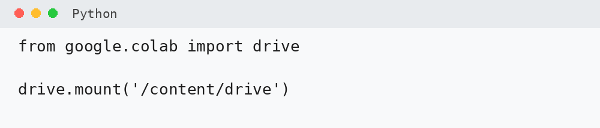

Import Pandas.

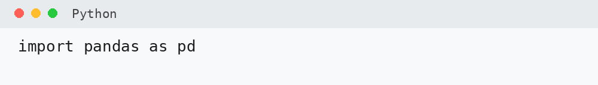

Tentukan lokasi dataset dan baca dataset.

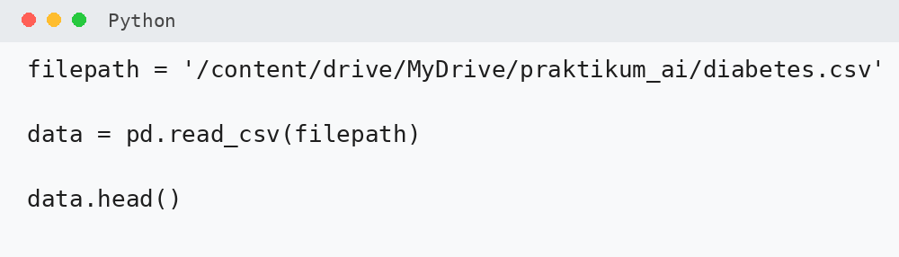

Periksa ukuran dataset dan informasi setiap kolom.

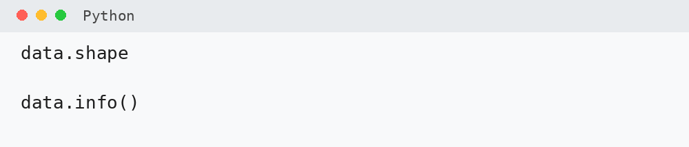

---

### 2. Mengingat Kembali Training dan Testing

Pada Modul 03, dataset dibagi satu kali menjadi **training data** dan **testing data**.

Masalahnya, hasil evaluasi dapat dipengaruhi oleh data mana yang kebetulan masuk ke training dan testing.

Cross-validation mencoba mengurangi ketergantungan terhadap satu pembagian data saja.

---

### 3. Mengenal K-Fold Cross Validation

Jika kita menggunakan `k = 5`, maka dataset dibagi menjadi lima fold.

Pada setiap putaran, satu fold digunakan sebagai testing data dan empat fold lainnya digunakan sebagai training data.

Jika menggunakan 5-fold cross-validation, model akan dilatih dan diuji sebanyak **5 kali**.

---

### 4. Mengapa Menggunakan Stratified K-Fold?

Periksa distribusi target diabetes.

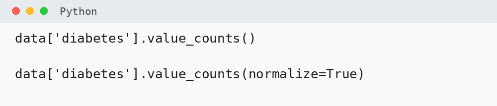

Stratified K-Fold berusaha mempertahankan proporsi kelas pada setiap fold agar kurang lebih sama dengan dataset awal.

!!! question "Coba Amati"
    Apakah jumlah data `diabetes = 0` dan `diabetes = 1` seimbang?

---

### 5. Menentukan Feature dan Target

Gunakan feature yang sama seperti Modul 03:

| Peran | Kolom |
|---|---|
| **Feature numerik (X)** | `age`, `hypertension`, `bmi`, `HbA1c_level`, `blood_glucose_level` |
| **Feature kategorikal (X)** | `gender`, `smoking_history` |
| **Target (y)** | `diabetes` |

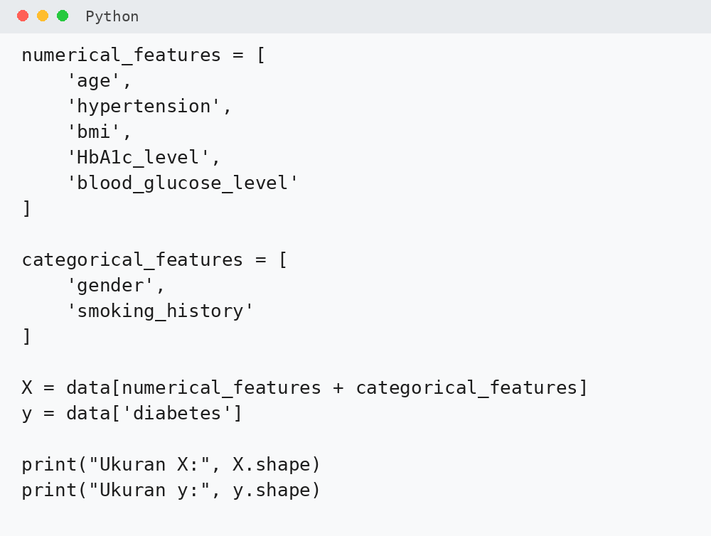

---

### 6. Membuat Preprocessing

Feature kategorikal perlu diubah menjadi bentuk numerik menggunakan `OneHotEncoder`.

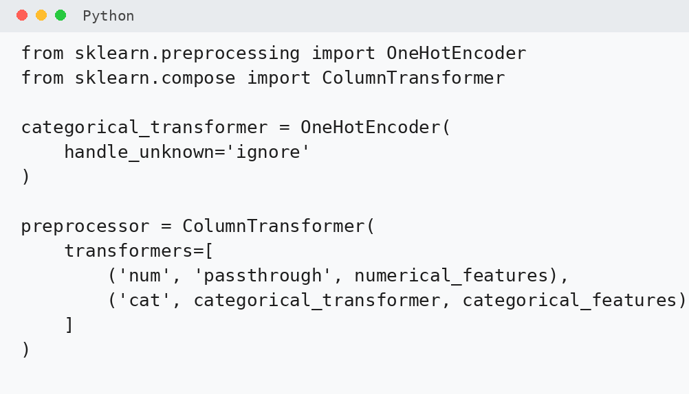

!!! note "Feature Numerik"
    Feature numerik menggunakan `passthrough` karena Random Forest tidak membutuhkan scaling.

---

### 7. Membuat Model Random Forest

Gunakan Pipeline untuk menggabungkan preprocessing dan Random Forest.

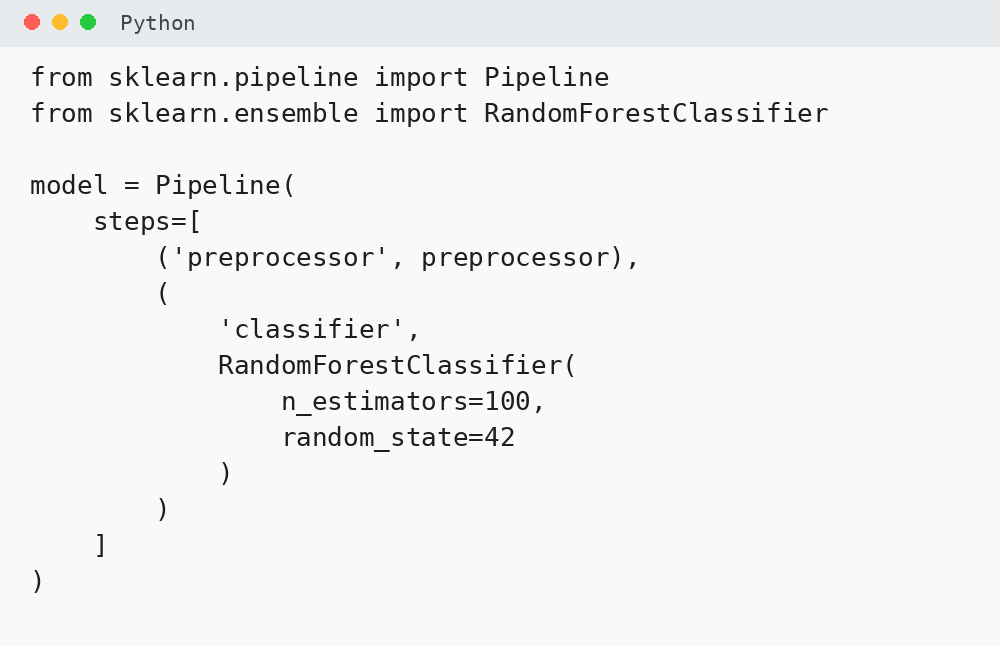

---

### 8. Membuat Stratified K-Fold

Gunakan **5-fold cross-validation**.

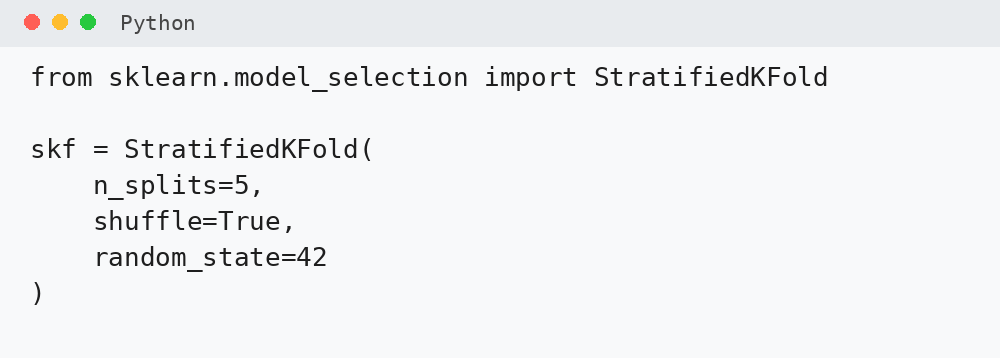

Parameter:

- `n_splits=5` → data dibagi menjadi 5 fold.
- `shuffle=True` → data diacak sebelum dibagi.
- `random_state=42` → hasil pengacakan dapat direproduksi.

---

### 9. Menyiapkan Evaluasi Model

Kita akan menghitung:

- Accuracy
- Precision
- Recall
- Confusion Matrix

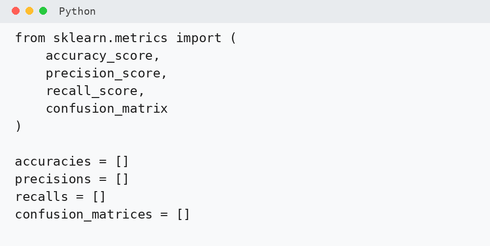

---

### 10. Training dan Testing pada Setiap Fold

Gunakan perulangan untuk menjalankan setiap fold.

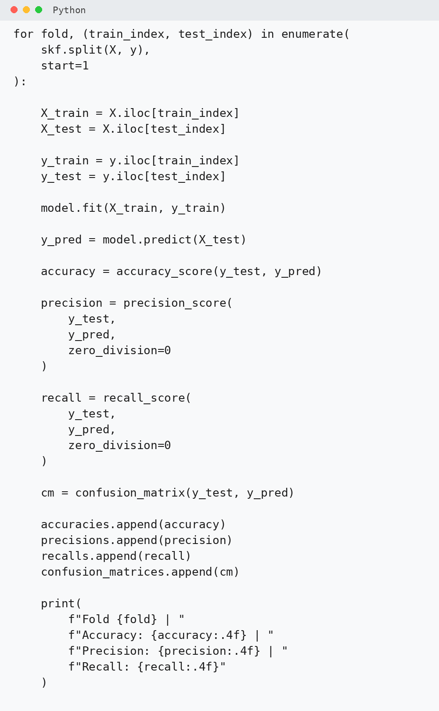

Pada setiap iterasi:

1. data dibagi menjadi training dan testing,
2. model dilatih,
3. model melakukan prediksi,
4. metric dihitung,
5. hasil disimpan.

!!! question "Coba Amati"
    Apakah nilai accuracy, precision, dan recall pada setiap fold sama?

---

### 11. Menghitung Rata-rata Performa

Hitung rata-rata accuracy, precision, recall, serta standar deviasi accuracy.

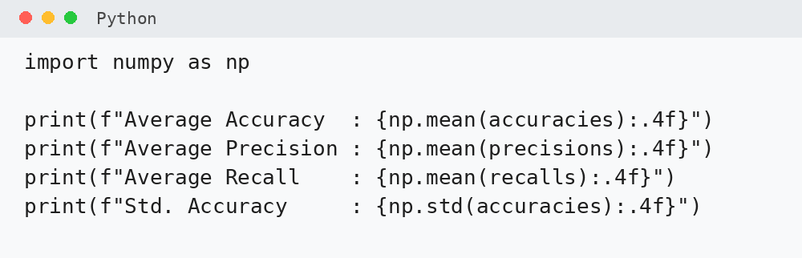

!!! note "Mengapa Standar Deviasi?"
    Nilai standar deviasi yang kecil menunjukkan hasil antar-fold relatif konsisten.

---

### 12. Menampilkan Hasil Setiap Fold

Simpan hasil setiap fold dalam DataFrame.

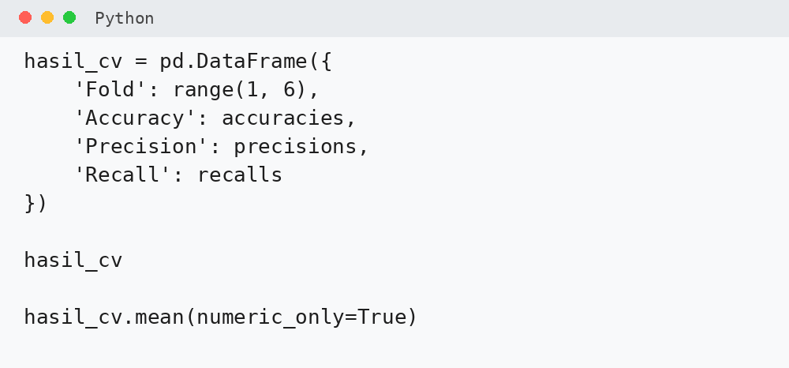

!!! question "Coba Analisis"
    Fold mana yang menghasilkan accuracy tertinggi?

    Apakah fold tersebut juga memiliki precision dan recall tertinggi?

---

### 13. Mengenal Confusion Matrix

Confusion matrix menunjukkan hasil klasifikasi secara lebih rinci.

| | Prediksi 0 | Prediksi 1 |
|---|---:|---:|
| **Aktual 0** | True Negative | False Positive |
| **Aktual 1** | False Negative | True Positive |

!!! warning "Perhatikan False Negative"
    Dalam konteks screening, False Negative berarti data dengan kelas positif diprediksi sebagai negatif.

    Karena itu, accuracy saja tidak selalu cukup untuk memahami performa model.

---

### 14. Menampilkan Confusion Matrix Setiap Fold

Gunakan `ConfusionMatrixDisplay`.

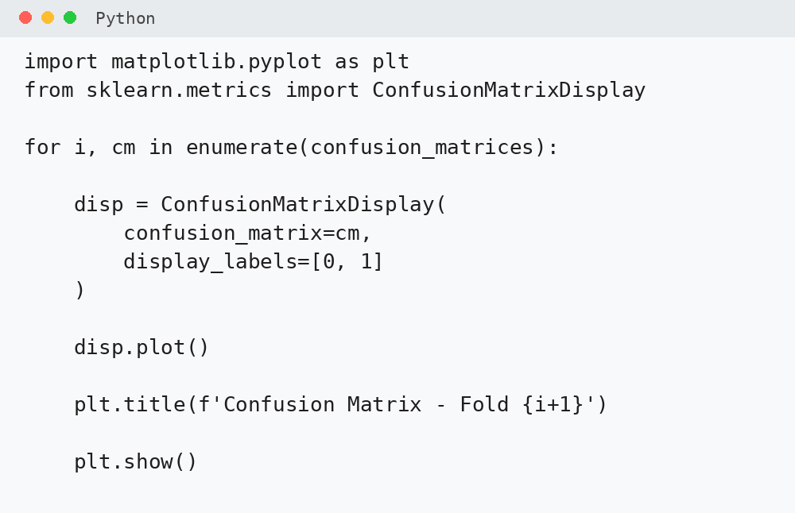

!!! question "Coba Amati"
    Pada fold mana jumlah False Negative paling banyak?

---

### 15. Membandingkan Cross-Validation dengan Train-Test Split

| Metode | Jumlah Evaluasi | Hasil |
|---|---:|---|
| Train-Test Split | 1 | Bergantung pada satu pembagian |
| 5-Fold Cross Validation | 5 | Rata-rata dari 5 pembagian |

!!! note "Ingat"
    Tujuan cross-validation bukan untuk membuat accuracy menjadi lebih tinggi.

    Cross-validation digunakan untuk memperoleh **estimasi performa yang lebih stabil**.

---

## Ringkasan

Pada praktikum ini kita telah melakukan proses:

```text
Dataset
   ↓
Feature (X) + Target (y)
   ↓
Stratified K-Fold
   ↓
Training + Testing pada setiap fold
   ↓
Accuracy
Precision
Recall
Confusion Matrix
   ↓
Rata-rata Performa
```

Konsep utamanya:

> **Cross-validation mengevaluasi model menggunakan beberapa pembagian data, bukan hanya satu pembagian training dan testing.**

---

# Tugas Praktikum

Kerjakan menggunakan Google Colab dan dataset `diabetes.csv`.

## 1. Membandingkan Jumlah Fold

Jalankan Stratified K-Fold menggunakan:

- `n_splits = 3`
- `n_splits = 5`
- `n_splits = 10`

Catat rata-rata accuracy.

| Jumlah Fold | Average Accuracy |
|---:|---:|
| 3 | ... |
| 5 | ... |
| 10 | ... |

Manakah yang menghasilkan average accuracy tertinggi?

---

## 2. Membandingkan Precision dan Recall

Untuk eksperimen `n_splits = 5`, catat:

- average accuracy,
- average precision,
- average recall.

| Metric | Nilai |
|---|---:|
| Accuracy | ... |
| Precision | ... |
| Recall | ... |

Metric mana yang memiliki nilai paling rendah?

---

## 3. Mengamati Variasi Antar-Fold

Gunakan hasil 5-fold cross-validation.

Catat accuracy setiap fold.

| Fold | Accuracy |
|---:|---:|
| 1 | ... |
| 2 | ... |
| 3 | ... |
| 4 | ... |
| 5 | ... |

Tentukan:

- fold dengan accuracy tertinggi,
- fold dengan accuracy terendah.

---

## 4. Confusion Matrix

Pilih satu confusion matrix dari hasil 5-fold.

Catat nilai:

- True Positive,
- True Negative,
- False Positive,
- False Negative.

Tuliskan satu kesimpulan berdasarkan confusion matrix tersebut.

---

## 5. Kesimpulan

Jelaskan dalam maksimal **3 kalimat**:

1. Mengapa cross-validation digunakan?
2. Apa fungsi `StratifiedKFold`?
3. Mengapa performa model sebaiknya tidak hanya dinilai dari accuracy?

---

## Pengumpulan

Simpan notebook dalam format `.ipynb`.

Gunakan nama file:

`NIM_Nama_Modul04.ipynb`

Pastikan seluruh cell sudah dijalankan dan output terlihat sebelum notebook dikumpulkan.
