# Modul 05: Stratified K-Fold Cross Validation dengan K-Nearest Neighbors (KNN)

## Tujuan

Setelah menyelesaikan praktikum ini, mahasiswa diharapkan mampu:

1. Memahami konsep dasar algoritma **K-Nearest Neighbors (KNN)**.
2. Memahami pengaruh nilai `k` terhadap hasil klasifikasi.
3. Memahami pentingnya scaling pada algoritma berbasis jarak.
4. Menerapkan **Stratified K-Fold Cross Validation** pada model KNN.
5. Mengevaluasi model menggunakan accuracy, precision, recall, dan confusion matrix.

## Persiapan

Sebelum memulai praktikum, siapkan:

- Google Colab.
- Google Drive.
- Dataset `diabetes.csv`.
- Library `pandas`, `numpy`, `matplotlib`, dan `scikit-learn`.
- Pemahaman mengenai Stratified K-Fold dari Modul 04.

Dataset dapat diunduh melalui tautan berikut:

[📥 Download diabetes.csv](data/diabetes.csv)

!!! tip "Persiapan Dataset"
    Simpan dataset pada folder `praktikum_ai` di Google Drive.

    Contoh lokasi:

    `MyDrive/praktikum_ai/diabetes.csv`

!!! note "Prasyarat"
    Pada Modul 04 kita menggunakan **Random Forest** untuk mempelajari Stratified K-Fold Cross Validation.

    Pada modul ini, metode evaluasinya tetap sama, tetapi model diganti menjadi **K-Nearest Neighbors (KNN)**.

---

## Dasar Teori

### 1. Apa itu K-Nearest Neighbors?

**K-Nearest Neighbors (KNN)** merupakan algoritma Machine Learning yang melakukan prediksi berdasarkan data-data yang paling dekat dengan data yang ingin diprediksi.

Secara sederhana:

1. tentukan sebuah data baru,
2. cari beberapa data training yang paling dekat,
3. lihat kelas dari tetangga tersebut,
4. pilih kelas yang paling banyak muncul.

Contoh jika `k = 5` dan lima tetangga terdekat mempunyai kelas:

```text
0, 0, 1, 0, 1
```

maka kelas yang paling banyak adalah `0`, sehingga data baru diprediksi sebagai kelas `0`.

---

### 2. Apa Arti Nilai k?

Pada KNN, `k` menunjukkan **jumlah tetangga terdekat** yang digunakan untuk menentukan prediksi.

Contoh:

- `k = 3` → menggunakan 3 tetangga terdekat.
- `k = 5` → menggunakan 5 tetangga terdekat.
- `k = 11` → menggunakan 11 tetangga terdekat.

Nilai `k` yang terlalu kecil dapat membuat model terlalu sensitif terhadap data lokal atau noise.

Nilai `k` yang terlalu besar dapat membuat keputusan menjadi terlalu umum.

!!! note "Tidak Ada Satu Nilai k yang Selalu Terbaik"
    Nilai `k` yang baik bergantung pada karakteristik dataset.

    Karena itu, beberapa nilai `k` biasanya dibandingkan melalui eksperimen.

---

### 3. KNN Menggunakan Jarak

KNN menentukan tetangga berdasarkan **jarak** antar-data.

Salah satu jarak yang paling umum digunakan adalah **Euclidean distance**.

Semakin kecil jaraknya, semakin dekat dua data tersebut.

Selain Euclidean distance, KNN juga dapat menggunakan metode jarak lain seperti **Manhattan distance**.

---

### 4. Mengapa Scaling Penting pada KNN?

Misalkan kita memiliki dua feature:

| Feature | Contoh Rentang |
|---|---:|
| `HbA1c_level` | 4–9 |
| `blood_glucose_level` | 80–300 |

Karena KNN menggunakan jarak, feature dengan rentang angka yang jauh lebih besar dapat mendominasi perhitungan jarak.

Karena itu, feature numerik perlu dibuat memiliki skala yang sebanding.

Pada modul ini kita menggunakan **StandardScaler**.

!!! warning "Berbeda dengan Random Forest"
    Random Forest pada Modul 04 tidak membutuhkan scaling.

    KNN **sensitif terhadap skala feature** karena keputusan dibuat berdasarkan jarak antar-data.

---

### 5. Data Numerik dan Kategorikal

Dataset diabetes memiliki feature numerik dan kategorikal.

| Tipe | Feature |
|---|---|
| Numerik | `age`, `bmi`, `HbA1c_level`, `blood_glucose_level` |
| Kategorikal | `gender`, `hypertension`, `heart_disease`, `smoking_history` |

Feature numerik akan diproses dengan **StandardScaler**, sedangkan feature kategorikal akan diproses dengan **OneHotEncoder**.

Kedua proses tersebut kemudian digabungkan menggunakan `ColumnTransformer`.

---

### 6. KNN dan Stratified K-Fold

Pada Modul 04 kita telah mempelajari bahwa satu pembagian training-testing dapat menghasilkan estimasi performa yang berbeda.

Karena itu, KNN akan dievaluasi menggunakan **Stratified K-Fold Cross Validation**.

Dengan 5-fold:

```text
Fold 1 → testing, lainnya training
Fold 2 → testing, lainnya training
Fold 3 → testing, lainnya training
Fold 4 → testing, lainnya training
Fold 5 → testing, lainnya training
```

Hasil dari seluruh fold kemudian dirata-ratakan.

---

### 7. Metric Evaluasi

Pada praktikum ini kita menggunakan:

- **Accuracy** → proporsi seluruh prediksi yang benar.
- **Precision** → dari semua prediksi positif, berapa yang benar-benar positif.
- **Recall** → dari semua data positif aktual, berapa yang berhasil ditemukan.
- **Confusion Matrix** → menunjukkan TP, TN, FP, dan FN.

!!! note "Ingat"
    Model dengan accuracy tertinggi belum tentu memiliki recall tertinggi.

    Metric perlu dibaca sesuai kebutuhan masalah.

---

## Langkah-langkah Praktikum

### 1. Membaca Dataset

Hubungkan Google Colab dengan Google Drive.

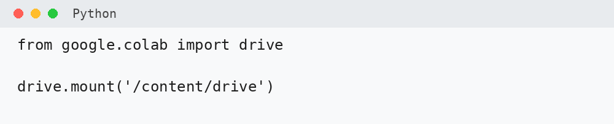

Baca dataset menggunakan Pandas.

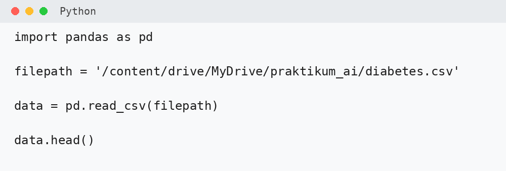

Periksa ukuran dan struktur dataset.

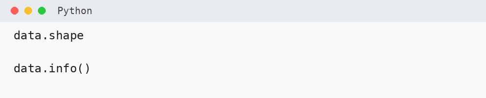

---

### 2. Menentukan Feature dan Target

Gunakan feature berikut.

| Peran | Kolom |
|---|---|
| **Feature numerik** | `age`, `bmi`, `HbA1c_level`, `blood_glucose_level` |
| **Feature kategorikal** | `gender`, `hypertension`, `heart_disease`, `smoking_history` |
| **Target** | `diabetes` |

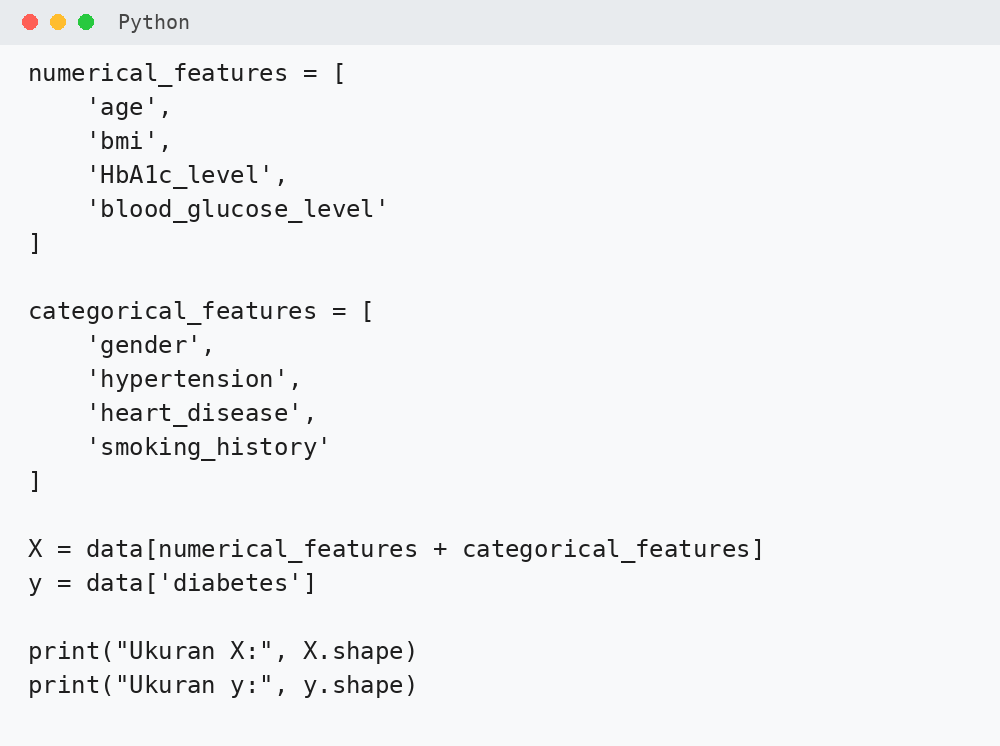

Periksa distribusi target.

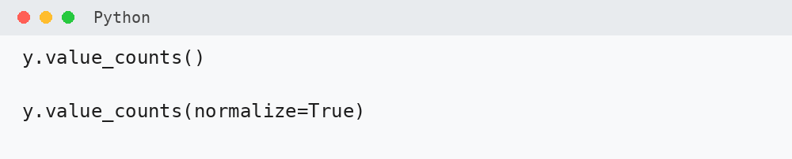


---

### 3. Membuat Preprocessing

Pada KNN:

- feature numerik → `StandardScaler`,
- feature kategorikal → `OneHotEncoder`.

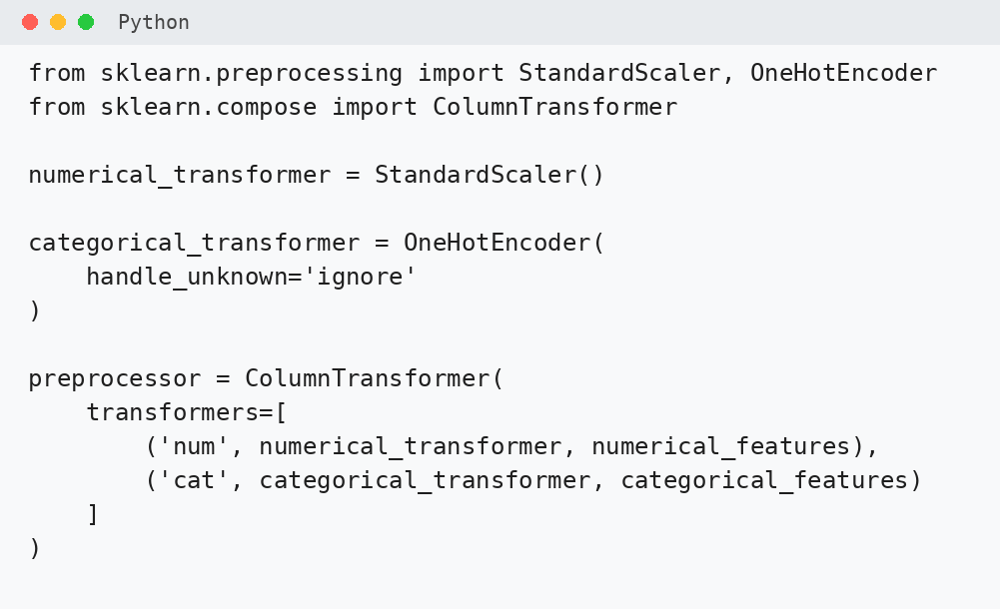

!!! note "Mengapa StandardScaler?"
    KNN menggunakan jarak antar-data.

    Jika satu feature memiliki skala yang jauh lebih besar, feature tersebut dapat mendominasi perhitungan jarak.

---

### 4. Membuat Model KNN

Import `KNeighborsClassifier` dan buat Pipeline.

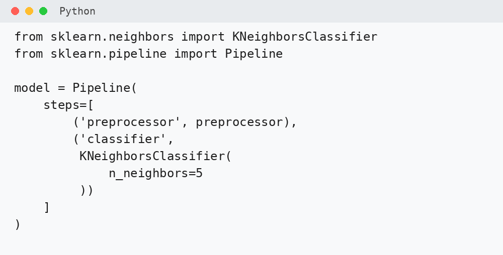

Pada praktikum awal kita menggunakan `k = 5`.

Artinya prediksi ditentukan menggunakan **5 tetangga terdekat**.

---

### 5. Membuat Stratified K-Fold

Gunakan 5-fold cross-validation.

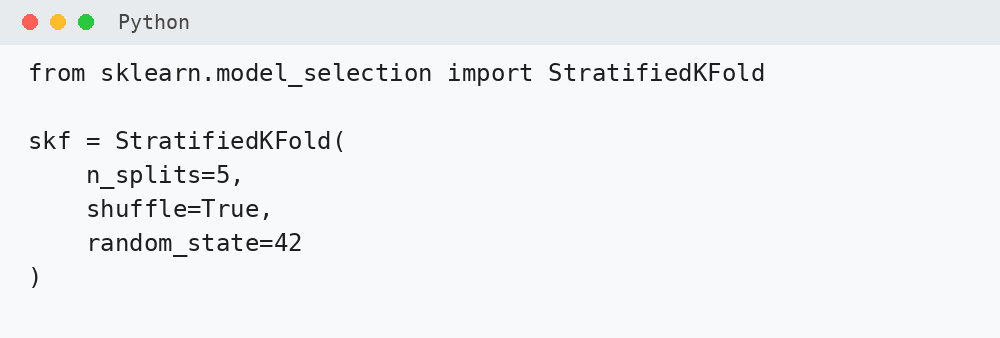

Parameter:

- `n_splits=5` → dataset dibagi menjadi lima fold.
- `shuffle=True` → data diacak sebelum dibagi.
- `random_state=42` → hasil pembagian dapat direproduksi.

---

### 6. Menyiapkan Metric Evaluasi

Siapkan accuracy, precision, recall, dan confusion matrix.

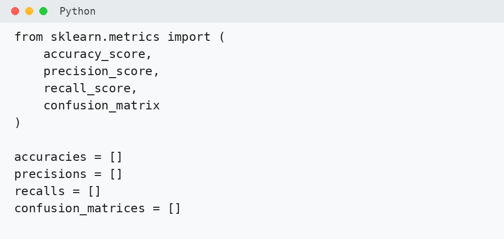

---

### 7. Training dan Testing Setiap Fold

Lakukan training dan testing pada masing-masing fold.

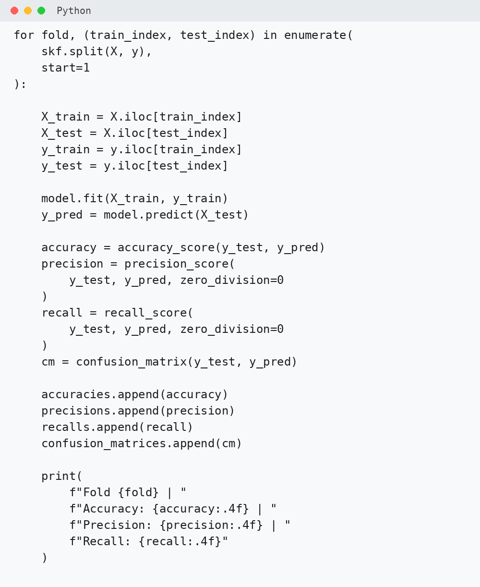

Pada setiap fold:

1. preprocessing dipelajari dari training data,
2. feature numerik di-scaling,
3. feature kategorikal di-encoding,
4. model KNN dilatih,
5. model melakukan prediksi,
6. metric dihitung.

!!! warning "Preprocessing Harus di Dalam Pipeline"
    Jangan melakukan `StandardScaler` pada seluruh dataset sebelum cross-validation.

    Jika informasi dari testing data ikut digunakan dalam proses scaling, dapat terjadi **data leakage**.

---

### 8. Menghitung Rata-rata Performa

Hitung rata-rata hasil seluruh fold.

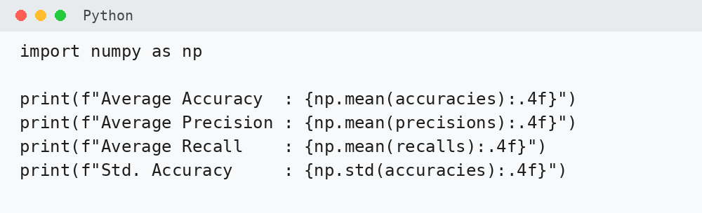

Perhatikan juga nilai standar deviasi accuracy.

Nilai standar deviasi yang lebih kecil menunjukkan hasil antar-fold yang lebih konsisten.

---

### 9. Menampilkan Hasil Setiap Fold

Buat tabel hasil cross-validation.

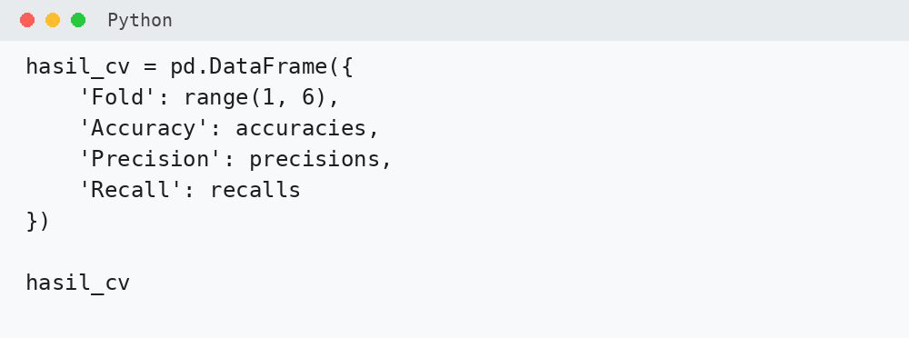

!!! question "Coba Analisis"
    Fold mana yang menghasilkan accuracy tertinggi?

    Apakah fold dengan accuracy tertinggi juga memiliki recall tertinggi?

---

### 10. Menampilkan Confusion Matrix

Tampilkan confusion matrix setiap fold.

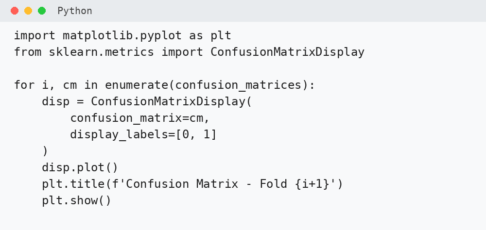


---

### 11. Memahami Pengaruh Nilai k

Model awal menggunakan `k = 5`.

Namun nilai `k` dapat diubah.

Secara umum:

| Nilai k | Karakteristik |
|---|---|
| Terlalu kecil | Lebih sensitif terhadap data lokal atau noise |
| Sedang | Dapat memberikan keseimbangan yang baik |
| Terlalu besar | Keputusan dapat menjadi terlalu umum |

!!! question "Prediksi"
    Sebelum melakukan eksperimen, menurut Anda apakah `k = 3`, `k = 5`, atau `k = 11` akan menghasilkan performa terbaik?

    Catat prediksi Anda dan bandingkan dengan hasil eksperimen.

---

### 12. Membandingkan KNN dan Random Forest

Modul 04 menggunakan Random Forest, sedangkan Modul 05 menggunakan KNN.

| Aspek | Random Forest | KNN |
|---|---|---|
| Dasar keputusan | Banyak decision tree | Tetangga terdekat |
| Scaling | Tidak wajib | Penting |
| Parameter yang dipelajari | Jumlah tree, kedalaman, dll. | Nilai `k`, distance |
| Prediksi | Voting antar-tree | Voting tetangga |


---

## Ringkasan

Pada praktikum ini kita telah melakukan proses:

```text
Dataset
   ↓
Feature Numerik + Kategorikal
   ↓
StandardScaler + OneHotEncoder
   ↓
Pipeline
   ↓
KNN
   ↓
Stratified 5-Fold
   ↓
Accuracy
Precision
Recall
Confusion Matrix
   ↓
Rata-rata Performa
```

Konsep penting:

> **KNN melakukan prediksi berdasarkan tetangga terdekat, sehingga skala feature dan pemilihan nilai `k` sangat memengaruhi hasil model.**

---


## Latihan Praktikum

Jawab pertanyaan berikut berdasarkan hasil yang diperoleh selama mengikuti langkah-langkah praktikum.

!!! note "Dikumpulkan"
    **Latihan Praktikum dan Tugas Praktikum sama-sama dikumpulkan.**

    Latihan Praktikum dikerjakan berdasarkan hasil praktikum utama di kelas.

### 1. Distribusi Target

Berdasarkan hasil:

`y.value_counts()` dan `y.value_counts(normalize=True)`

jawab:

1. Apakah jumlah data `diabetes = 0` dan `diabetes = 1` seimbang?
2. Kelas mana yang memiliki jumlah data lebih banyak?
3. Mengapa kondisi tersebut menjadi alasan penggunaan Stratified K-Fold?

---

### 2. Hasil Antar-Fold

Perhatikan hasil accuracy, precision, dan recall pada lima fold.

Jawab:

1. Apakah nilai ketiga metric sama pada setiap fold?
2. Fold mana yang menghasilkan accuracy tertinggi?
3. Fold mana yang menghasilkan recall tertinggi?

Tuliskan hasilnya pada tabel berikut.

| Fold | Accuracy | Precision | Recall |
|---:|---:|---:|---:|
| 1 | ... | ... | ... |
| 2 | ... | ... | ... |
| 3 | ... | ... | ... |
| 4 | ... | ... | ... |
| 5 | ... | ... | ... |

---

### 3. Rata-rata dan Konsistensi Model

Catat hasil berikut:

| Metric | Nilai |
|---|---:|
| Average Accuracy | ... |
| Average Precision | ... |
| Average Recall | ... |
| Std. Accuracy | ... |

Jawab:

1. Metric mana yang memiliki nilai rata-rata paling tinggi?
2. Metric mana yang memiliki nilai rata-rata paling rendah?
3. Apa arti nilai standar deviasi accuracy yang diperoleh?

---

### 4. Confusion Matrix

Pilih **satu fold** dari hasil praktikum.

Catat nilai:

- True Positive (TP)
- True Negative (TN)
- False Positive (FP)
- False Negative (FN)

Kemudian jawab:

1. Berapa jumlah False Negative pada fold tersebut?
2. Apa arti False Negative pada kasus klasifikasi diabetes?

---

### 5. Pemahaman KNN

Jawab secara singkat:

1. Apa arti `k = 5` pada KNN?
2. Mengapa feature numerik perlu di-scaling sebelum digunakan oleh KNN?
3. Mengapa `StandardScaler` ditempatkan di dalam Pipeline?
4. Apa perbedaan utama cara kerja KNN dengan Random Forest yang digunakan pada Modul 04?

---

# Tugas Praktikum

Tugas berikut merupakan **eksperimen lanjutan** dari praktikum utama.

Kerjakan menggunakan Google Colab dan dataset `diabetes.csv`.

!!! info "Pengerjaan Tugas"
    Tugas Praktikum mulai dikerjakan di kelas setelah Latihan Praktikum selesai.

    Jika belum selesai pada waktu praktikum, tugas **boleh dilanjutkan di rumah**.

    **Latihan Praktikum dan Tugas Praktikum dikumpulkan dalam notebook yang berbeda.**

## 1. Membandingkan Nilai k

Uji nilai:

- `k = 3`
- `k = 5`
- `k = 7`
- `k = 9`
- `k = 11`

Gunakan Stratified 5-Fold Cross Validation.

| k | Average Accuracy |
|---:|---:|
| 3 | ... |
| 5 | ... |
| 7 | ... |
| 9 | ... |
| 11 | ... |

Tentukan nilai `k` dengan average accuracy tertinggi.

---

## 2. Accuracy, Precision, dan Recall

Untuk nilai `k` terbaik dari soal sebelumnya, catat:

| Metric | Nilai |
|---|---:|
| Average Accuracy | ... |
| Average Precision | ... |
| Average Recall | ... |

Metric mana yang menghasilkan nilai paling rendah?

---

## 3. Pengaruh Scaling

Buat dua model:

- **Model A** → feature numerik menggunakan `StandardScaler`.
- **Model B** → feature numerik menggunakan `passthrough`.

Bandingkan average accuracy keduanya.

| Model | Average Accuracy |
|---|---:|
| Dengan StandardScaler | ... |
| Tanpa StandardScaler | ... |

Tuliskan satu kesimpulan mengenai pengaruh scaling pada KNN.

---

## 4. Membandingkan Metode Jarak

Gunakan nilai `k` terbaik.

Bandingkan:

- Euclidean distance,
- Manhattan distance.

| Distance | Average Accuracy |
|---|---:|
| Euclidean | ... |
| Manhattan | ... |

Metode mana yang menghasilkan performa lebih baik pada eksperimen Anda?

---

## 5. Kesimpulan

Tuliskan kesimpulan maksimal **4 kalimat** mengenai:

1. cara kerja sederhana KNN,
2. pengaruh nilai `k`,
3. pentingnya scaling,
4. hasil KNN dibandingkan dengan Random Forest pada Modul 04.

---

## Pengumpulan

Yang dikumpulkan terdiri dari **dua notebook terpisah**.

### 1. Notebook Latihan Praktikum

Notebook ini berisi:

- langkah praktikum utama,
- output hasil running,
- jawaban seluruh bagian **Latihan Praktikum**.

Gunakan nama file:

`NIM_Nama_Modul05_Latihan.ipynb`

---

### 2. Notebook Tugas Praktikum

Notebook ini berisi:

- eksperimen pada bagian **Tugas Praktikum**,
- hasil perbandingan,
- tabel hasil,
- kesimpulan.

Gunakan nama file:

`NIM_Nama_Modul05_Tugas.ipynb`

!!! note "Catatan"
    Tugas Praktikum mulai dikerjakan di kelas.

    Jika belum selesai, pengerjaan dapat dilanjutkan di rumah.

Pastikan sebelum dikumpulkan:

- seluruh cell yang diperlukan sudah dijalankan,
- output terlihat,
- jawaban dan kesimpulan sudah dituliskan,
- kedua notebook dikumpulkan sesuai tempat pengumpulan di LMS.
