# Modul 06: Stratified K-Fold Cross Validation dengan Support Vector Machine (SVM)

## Tujuan

Setelah menyelesaikan praktikum ini, mahasiswa diharapkan mampu:

1. Memahami prinsip dasar **Support Vector Machine (SVM)**.
2. Memahami peran **hyperplane**, **margin**, dan **support vector**.
3. Memahami fungsi **kernel** pada SVM.
4. Menerapkan preprocessing numerik dan kategorikal menggunakan Pipeline.
5. Mengevaluasi SVM menggunakan Stratified 5-Fold Cross Validation.
6. Membandingkan accuracy, precision, recall, F1-score, dan confusion matrix.

## Persiapan

Siapkan:

- Google Colab.
- Google Drive.
- Dataset `diabetes.csv`.
- Library `pandas`, `numpy`, `matplotlib`, dan `scikit-learn`.
- Pemahaman mengenai StandardScaler, Pipeline, confusion matrix, dan Stratified K-Fold dari Modul 04–05.

Dataset:

[📥 Download diabetes.csv](data/diabetes.csv)

!!! tip "Persiapan Dataset"
    Simpan dataset pada folder:

    `MyDrive/praktikum_ai/diabetes.csv`

---

# Dasar Teori

## 1. Apa itu Support Vector Machine?

**Support Vector Machine (SVM)** merupakan algoritma Machine Learning yang mencari batas pemisah terbaik antara dua kelas.

Batas tersebut disebut **hyperplane**.

Pada kasus dua feature, hyperplane dapat dibayangkan sebagai sebuah garis yang memisahkan dua kelompok data.

Tujuan SVM bukan hanya mencari garis pemisah, tetapi mencari garis yang mempunyai **margin terbesar** terhadap data dari kedua kelas.

---

## 2. Apa itu Margin?

**Margin** adalah jarak antara hyperplane dengan data terdekat dari masing-masing kelas.

Semakin besar margin, semakin jelas pemisahan antar-kelas.

Secara sederhana:

```text
Kelas 0        |        Kelas 1
● ● ●          |          ▲ ▲ ▲
 ● ●        margin       ▲ ▲
             |
         hyperplane
```

SVM berusaha mencari hyperplane dengan margin yang baik.

---

## 3. Apa itu Support Vector?

Data yang berada paling dekat dengan hyperplane disebut **support vector**.

Support vector sangat penting karena titik-titik inilah yang banyak menentukan posisi hyperplane.

!!! note "Intuisi"
    Tidak semua data mempunyai pengaruh yang sama terhadap batas keputusan SVM.

    Titik yang paling dekat dengan batas keputusan mempunyai peran penting.

---

## 4. Bagaimana jika Data Tidak Bisa Dipisahkan dengan Garis Lurus?

Tidak semua data dapat dipisahkan dengan hyperplane linear.

Untuk kondisi tersebut, SVM menggunakan konsep **kernel**.

Kernel membantu SVM membuat batas keputusan yang lebih fleksibel tanpa harus menghitung transformasi ke dimensi tinggi secara eksplisit.

Beberapa kernel yang umum:

| Kernel | Gambaran Sederhana |
|---|---|
| `linear` | batas keputusan relatif lurus |
| `poly` | hubungan berbentuk polinomial |
| `rbf` | batas nonlinear dan fleksibel |
| `sigmoid` | bentuk menyerupai fungsi sigmoid |

Pada praktikum utama kita menggunakan:

`kernel='rbf'`

---

## 5. Parameter C

Parameter `C` mengatur kompromi antara:

- mendapatkan margin yang lebih lebar,
- dan mengurangi kesalahan klasifikasi pada data training.

Secara sederhana:

| Nilai C | Karakteristik |
|---|---|
| C kecil | lebih toleran terhadap beberapa kesalahan, margin dapat lebih lebar |
| C besar | lebih berusaha mengklasifikasikan training data dengan benar |

!!! warning "Tidak Selalu Semakin Besar Semakin Baik"
    Nilai `C` yang besar tidak otomatis menghasilkan model terbaik pada data baru.

---

## 6. Parameter Gamma pada RBF Kernel

Pada RBF kernel, `gamma` mengontrol seberapa jauh pengaruh sebuah data training.

Secara sederhana:

- `gamma` kecil → pengaruh suatu data lebih luas.
- `gamma` besar → pengaruh suatu data lebih lokal.

Nilai yang terlalu besar dapat membuat model terlalu mengikuti pola lokal.

---

## 7. Mengapa SVM Membutuhkan Scaling?

SVM, terutama dengan RBF kernel, menggunakan jarak antar-data.

Jika feature mempunyai skala yang sangat berbeda, feature dengan nilai numerik besar dapat lebih mendominasi.

Karena itu, feature numerik pada praktikum ini diproses menggunakan:

`StandardScaler`

!!! note "Hubungan dengan Modul 05"
    Sama seperti KNN, SVM termasuk algoritma yang sensitif terhadap skala feature.

---

## 8. Preprocessing Data

Dataset memiliki feature numerik dan kategorikal.

| Tipe | Feature |
|---|---|
| Numerik | `age`, `bmi`, `HbA1c_level`, `blood_glucose_level` |
| Kategorikal | `gender`, `hypertension`, `heart_disease`, `smoking_history` |
| Target | `diabetes` |

Feature numerik:

`StandardScaler`

Feature kategorikal:

`OneHotEncoder`

Keduanya dimasukkan ke dalam `Pipeline` agar preprocessing dilakukan dengan benar pada setiap fold.

---

## 9. Mengapa Tetap Menggunakan Stratified K-Fold?

Tujuannya sama seperti Modul 04 dan Modul 05:

- model diuji pada beberapa pembagian data,
- setiap data mendapat kesempatan menjadi testing data,
- proporsi kelas tetap dijaga pada setiap fold,
- performa tidak bergantung pada satu train-test split saja.

Pada modul ini digunakan:

**Stratified 5-Fold Cross Validation**

---

## 10. F1-Score

Selain accuracy, precision, dan recall, pada Modul 06 kita menambahkan:

**F1-Score**

F1-Score menggabungkan precision dan recall menjadi satu nilai.

Secara intuitif:

> F1-Score tinggi jika precision dan recall sama-sama baik.

Metric ini berguna ketika kita ingin mempertimbangkan keseimbangan precision dan recall.

---

# Langkah-langkah Praktikum

## 1. Membaca Dataset

Hubungkan Google Colab dengan Google Drive.

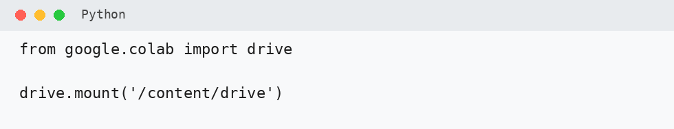

Baca dataset.

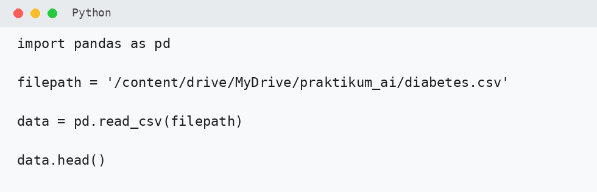

Periksa ukuran dan tipe data.

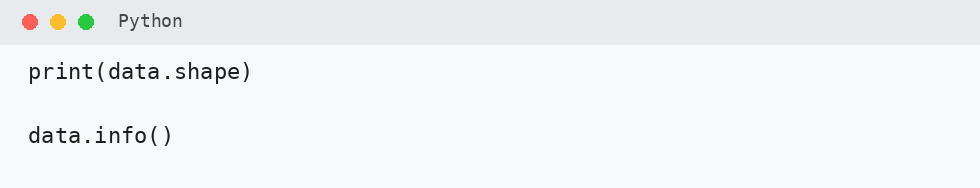

---

## 2. Menentukan Feature dan Target

Gunakan feature yang sama seperti Modul 05.

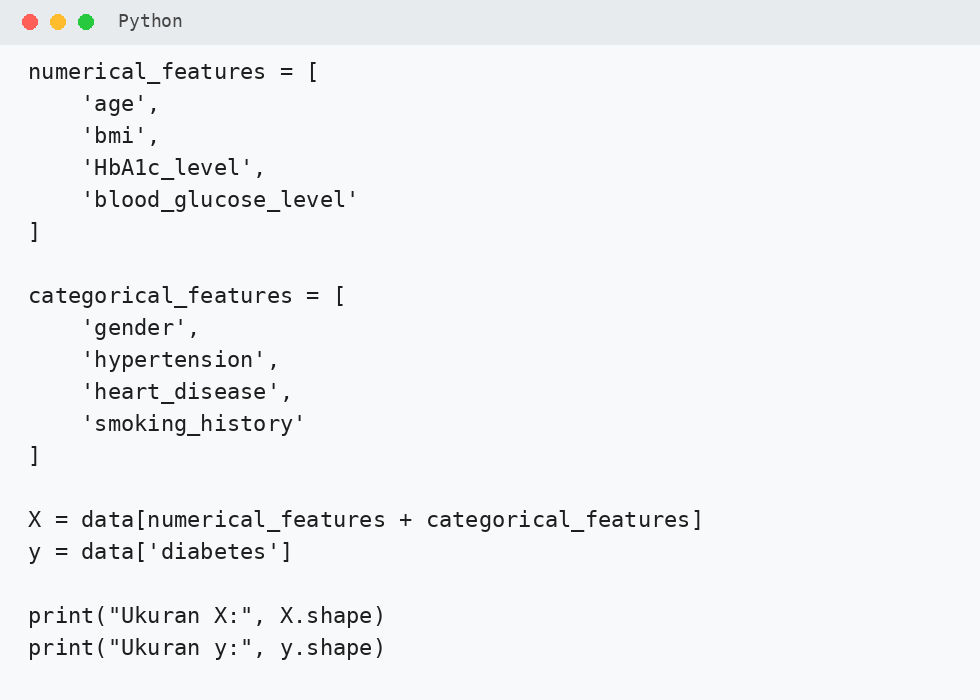

Periksa distribusi target.

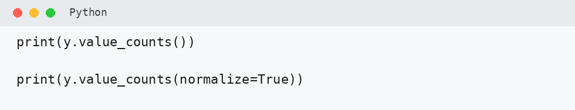

---

## 3. Membuat Preprocessing

Gunakan:

- `StandardScaler` untuk feature numerik,
- `OneHotEncoder` untuk feature kategorikal.

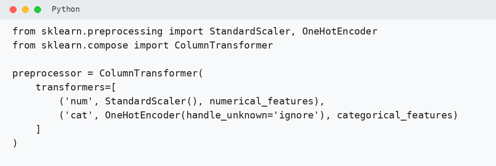

!!! warning "Penting"
    Scaling tetap dilakukan **di dalam Pipeline**, bukan pada seluruh dataset sebelum cross-validation.

---

## 4. Membuat Model SVM

Gunakan SVM dengan RBF kernel.

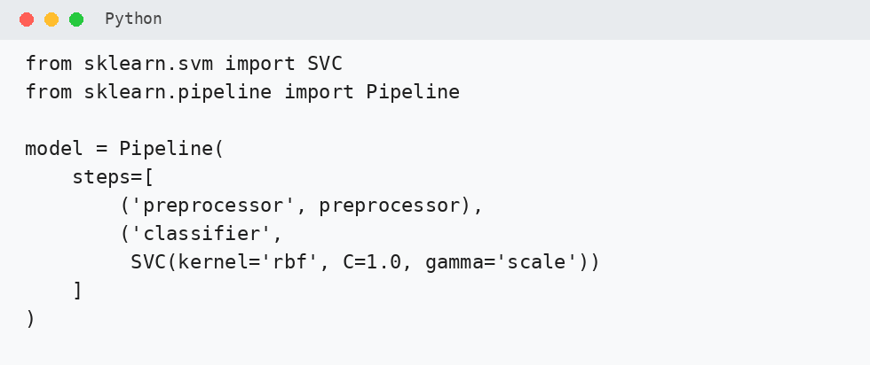

Parameter awal:

- `kernel='rbf'`
- `C=1.0`
- `gamma='scale'`

---

## 5. Membuat Stratified 5-Fold

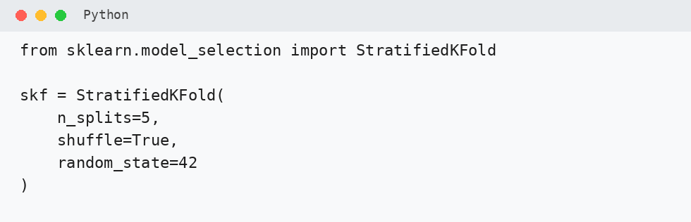

Kita menggunakan lima fold agar konsisten dengan modul sebelumnya dan waktu komputasi tetap realistis.

---

## 6. Menyiapkan Metric

Gunakan:

- Accuracy
- Precision
- Recall
- F1-Score
- Confusion Matrix

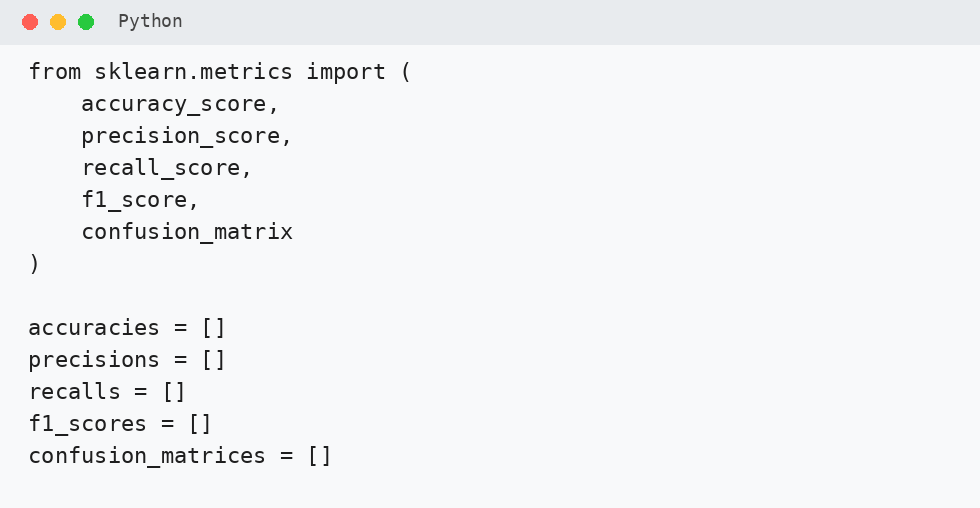

---

## 7. Training dan Testing Setiap Fold

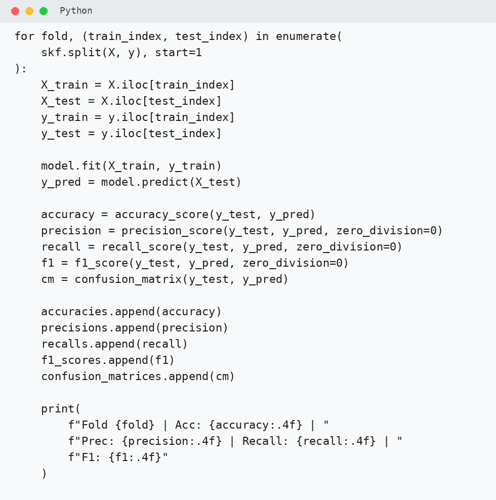

Pada setiap fold:

1. preprocessing dipelajari dari training data,
2. feature numerik di-scaling,
3. feature kategorikal di-encoding,
4. SVM dilatih,
5. prediksi dilakukan,
6. metric dihitung.

---

## 8. Menghitung Rata-rata Performa

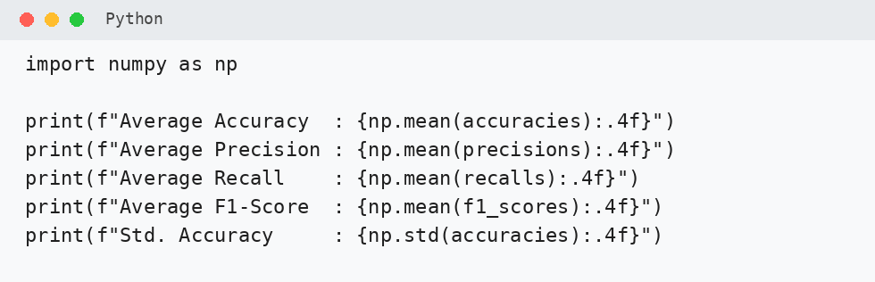

Perhatikan:

- average accuracy,
- average precision,
- average recall,
- average F1-score,
- standar deviasi accuracy.

---

## 9. Menampilkan Hasil Tiap Fold

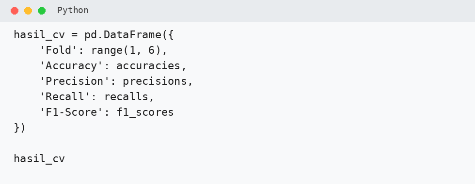

Bandingkan hasil antar-fold.

---

## 10. Menampilkan Confusion Matrix

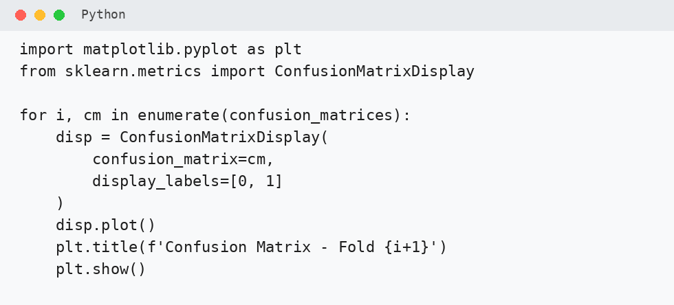

Perhatikan terutama:

- False Positive,
- False Negative.

---

## 11. Membandingkan Kernel

Contoh model kernel linear:

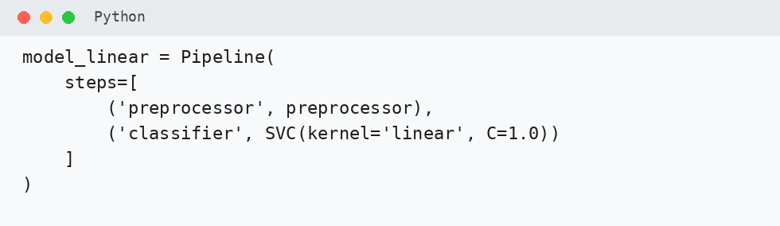

Contoh model RBF:

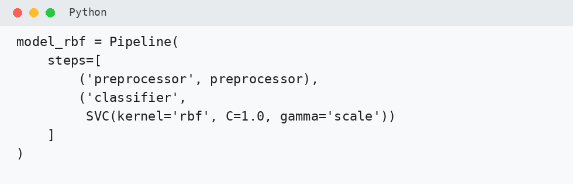

Perbandingan kernel akan dilakukan pada Tugas Praktikum.

---

## 12. Tuning Parameter

Untuk eksperimen lanjutan dapat digunakan `GridSearchCV`.

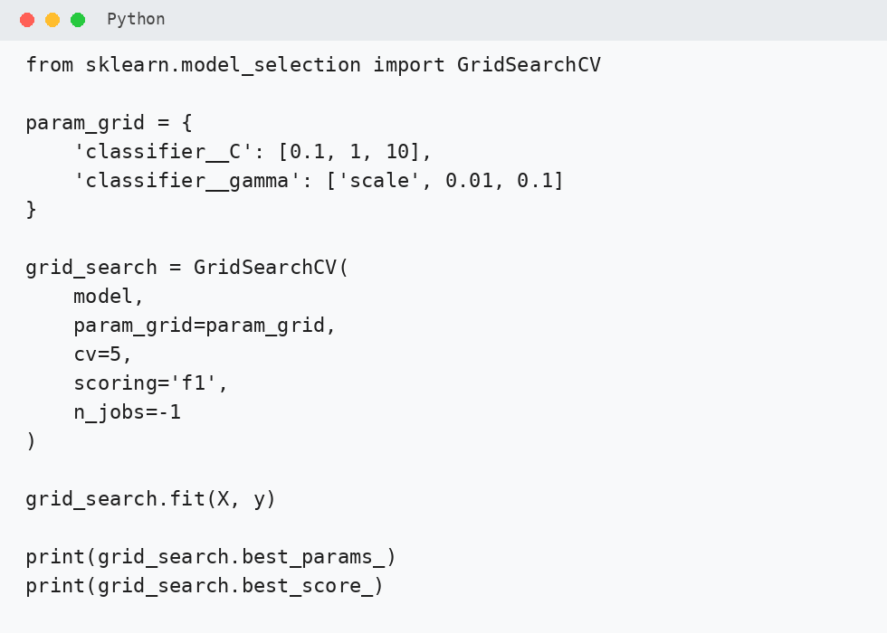

Pada modul ini grid dibuat lebih kecil agar waktu komputasi tetap realistis.

---

# Latihan Praktikum

!!! note "Dikumpulkan"
    **Latihan Praktikum dikumpulkan sebagai notebook tersendiri.**

    Gunakan hasil praktikum utama untuk menjawab bagian berikut.

## 1. Distribusi Target

Berdasarkan hasil `y.value_counts()`:

1. Berapa proporsi kelas `diabetes = 0`?
2. Berapa proporsi kelas `diabetes = 1`?
3. Mengapa Stratified K-Fold lebih sesuai dibanding pembagian fold biasa untuk dataset ini?

---

## 2. Hasil Antar-Fold

Lengkapi tabel:

| Fold | Accuracy | Precision | Recall | F1-Score |
|---:|---:|---:|---:|---:|
| 1 | ... | ... | ... | ... |
| 2 | ... | ... | ... | ... |
| 3 | ... | ... | ... | ... |
| 4 | ... | ... | ... | ... |
| 5 | ... | ... | ... | ... |

Jawab:

1. Fold mana yang memiliki accuracy tertinggi?
2. Fold mana yang memiliki recall tertinggi?
3. Apakah fold dengan accuracy tertinggi selalu memiliki F1-score tertinggi?

---

## 3. Rata-rata Metric

Catat:

| Metric | Nilai |
|---|---:|
| Average Accuracy | ... |
| Average Precision | ... |
| Average Recall | ... |
| Average F1-Score | ... |
| Std. Accuracy | ... |

Jawab:

1. Metric mana yang memiliki nilai paling rendah?
2. Apa arti standar deviasi accuracy yang diperoleh?

---

## 4. Confusion Matrix

Pilih satu fold.

Catat:

- TP
- TN
- FP
- FN

Jawab:

1. Berapa False Negative?
2. Apa arti False Negative pada kasus diabetes?
3. Jika tujuan model adalah screening awal, metric apa yang perlu lebih diperhatikan?

---

## 5. Pemahaman SVM

Jawab singkat:

1. Apa yang dimaksud hyperplane?
2. Apa yang dimaksud support vector?
3. Mengapa StandardScaler penting untuk SVM?
4. Apa fungsi kernel?
5. Apa perbedaan sederhana kernel linear dan RBF?

---

# Tugas Praktikum

Tugas Praktikum merupakan **eksperimen lanjutan**.

!!! info "Pengerjaan Tugas"
    Mulai dikerjakan di kelas setelah Latihan Praktikum selesai.

    Jika belum selesai, boleh dilanjutkan di rumah.

    **Tugas Praktikum dikumpulkan sebagai notebook terpisah dari Latihan Praktikum.**

## 1. Perbandingan Kernel

Bandingkan:

- Linear
- Polynomial
- RBF
- Sigmoid

Gunakan Stratified 5-Fold.

Lengkapi:

| Kernel | Accuracy | Precision | Recall | F1-Score |
|---|---:|---:|---:|---:|
| Linear | ... | ... | ... | ... |
| Poly | ... | ... | ... | ... |
| RBF | ... | ... | ... | ... |
| Sigmoid | ... | ... | ... | ... |

Tentukan kernel dengan F1-score tertinggi.

---

## 2. Analisis Kernel Terbaik

Untuk kernel terbaik:

1. tampilkan confusion matrix,
2. catat TP, TN, FP, dan FN,
3. jelaskan mengapa kernel tersebut dipilih.

Jawaban maksimal **4 kalimat**.

---

## 3. Pengaruh Parameter C

Gunakan RBF kernel.

Bandingkan:

- `C = 0.1`
- `C = 1`
- `C = 10`

Catat average F1-score.

| C | Average F1-Score |
|---:|---:|
| 0.1 | ... |
| 1 | ... |
| 10 | ... |

Apa pengaruh perubahan `C` pada eksperimen Anda?

---

## 4. Tuning C dan Gamma

Gunakan GridSearchCV dengan:

```text
C = [0.1, 1, 10]
gamma = ['scale', 0.01, 0.1]
```

Gunakan:

- `cv=5`
- `scoring='f1'`

Catat:

- nilai `C` terbaik,
- nilai `gamma` terbaik,
- F1-score terbaik.

---

## 5. Kesimpulan

Tuliskan maksimal **5 kalimat** mengenai:

1. prinsip kerja SVM,
2. pentingnya scaling,
3. pengaruh kernel,
4. pengaruh `C` dan `gamma`,
5. hasil SVM dibandingkan KNN pada Modul 05.

---

# Pengumpulan

Dikumpulkan dalam **dua notebook terpisah**.

## 1. Notebook Latihan Praktikum

Nama file:

`NIM_Nama_Modul06_Latihan.ipynb`

Berisi:

- langkah praktikum utama,
- output,
- jawaban Latihan Praktikum.

## 2. Notebook Tugas Praktikum

Nama file:

`NIM_Nama_Modul06_Tugas.ipynb`

Berisi:

- eksperimen kernel,
- eksperimen parameter,
- tabel hasil,
- confusion matrix,
- kesimpulan.

Pastikan seluruh cell telah dijalankan dan output terlihat sebelum dikumpulkan.
