# Modul 07: Stratified K-Fold Cross Validation dengan Neural Network (MLP)

## Tujuan

Setelah menyelesaikan praktikum ini, mahasiswa diharapkan mampu:

1. Memahami prinsip dasar **Neural Network / Multi-Layer Perceptron (MLP)**.
2. Memahami fungsi input layer, hidden layer, neuron, bobot, bias, dan activation function.
3. Memahami pentingnya `StandardScaler` pada Neural Network.
4. Membuat model MLP menggunakan `Pipeline`.
5. Mengevaluasi MLP menggunakan Stratified 5-Fold Cross Validation.
6. Membandingkan accuracy, precision, recall, F1-score, confusion matrix, dan jumlah iterasi.

## Persiapan

Siapkan:

- Google Colab.
- Google Drive.
- Dataset `diabetes.csv`.
- Library `pandas`, `numpy`, `matplotlib`, dan `scikit-learn`.
- Pemahaman mengenai StandardScaler, Pipeline, confusion matrix, dan Stratified K-Fold dari modul sebelumnya.

[📥 Download diabetes.csv](data/diabetes.csv)

!!! tip "Persiapan Dataset"
    Simpan dataset pada:

    `MyDrive/praktikum_ai/diabetes.csv`

---

# Dasar Teori

## 1. Apa itu Neural Network?

**Neural Network** adalah model Machine Learning yang tersusun dari unit-unit sederhana yang disebut **neuron**.

Pada modul ini kita menggunakan **Multi-Layer Perceptron (MLP)**, yaitu neural network dengan satu atau lebih hidden layer.

Secara sederhana:

```text
Input Layer
     ↓
Hidden Layer
     ↓
Output Layer
```

---

## 2. Arsitektur MLP

Pada praktikum utama digunakan:

```text
hidden_layer_sizes = (64, 32)
```

Artinya:

- hidden layer pertama memiliki 64 neuron,
- hidden layer kedua memiliki 32 neuron.

Jumlah layer dan neuron memengaruhi kapasitas model untuk mempelajari pola.

!!! note "Tidak Selalu Lebih Dalam Lebih Baik"
    Arsitektur yang lebih besar membutuhkan komputasi lebih banyak dan dapat lebih mudah mengalami overfitting.

---

## 3. Cara Kerja Sederhana Neuron

Sebuah neuron:

1. menerima input,
2. mengalikan input dengan bobot,
3. menambahkan bias,
4. menerapkan activation function,
5. menghasilkan output.

Secara sederhana:

```text
Input × Weight
      ↓
    + Bias
      ↓
Activation Function
      ↓
    Output
```

Bobot diperbarui selama training agar kesalahan prediksi semakin kecil.

---

## 4. Activation Function

Activation function membantu model mempelajari hubungan nonlinear.

| Activation | Gambaran |
|---|---|
| `relu` | umum digunakan pada hidden layer |
| `tanh` | output sekitar -1 sampai 1 |
| `logistic` | fungsi sigmoid, output sekitar 0 sampai 1 |

Praktikum utama menggunakan:

`activation='relu'`

---

## 5. Optimizer

Optimizer menentukan bagaimana bobot diperbarui selama training.

Beberapa pilihan pada `MLPClassifier`:

- `adam`
- `sgd`
- `lbfgs`

Pada praktikum utama digunakan:

`solver='adam'`

---

## 6. Mengapa StandardScaler Penting?

Neural Network sensitif terhadap perbedaan skala feature.

Feature yang memiliki rentang sangat berbeda dapat membuat proses optimasi menjadi lebih sulit.

Karena itu feature numerik diproses menggunakan:

`StandardScaler`

!!! note "Hubungan dengan Modul 05–06"
    KNN dan SVM juga menggunakan scaling. Pada Neural Network, scaling membantu proses optimasi bobot menjadi lebih stabil.

---

## 7. Early Stopping

Training dapat dihentikan ketika performa validation tidak lagi membaik.

Pada modul ini:

`early_stopping=True`

Tujuannya:

- mengurangi risiko overfitting,
- menghindari training terlalu lama.

---

## 8. Stratified 5-Fold

Model dievaluasi menggunakan **Stratified 5-Fold Cross Validation**.

Tujuannya:

- evaluasi dilakukan pada beberapa pembagian data,
- distribusi kelas target tetap terjaga,
- hasil tidak hanya bergantung pada satu train-test split.

---

## 9. Metric Evaluasi

Metric yang digunakan:

- Accuracy
- Precision
- Recall
- F1-Score
- Confusion Matrix

Selain itu kita juga melihat:

- standar deviasi accuracy,
- jumlah iterasi hingga training berhenti.

---

# Langkah-langkah Praktikum

## 1. Membaca Dataset

Hubungkan Google Colab dengan Google Drive.

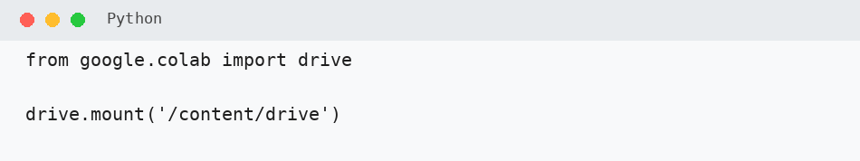

Baca dataset.

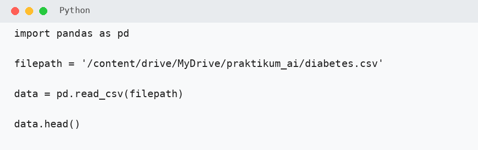

Periksa struktur dataset.

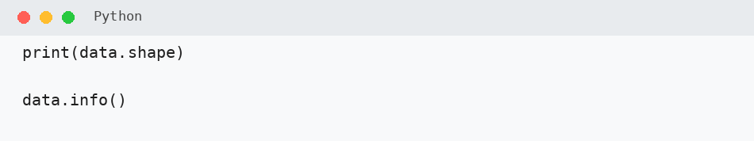

---

## 2. Menentukan Feature dan Target

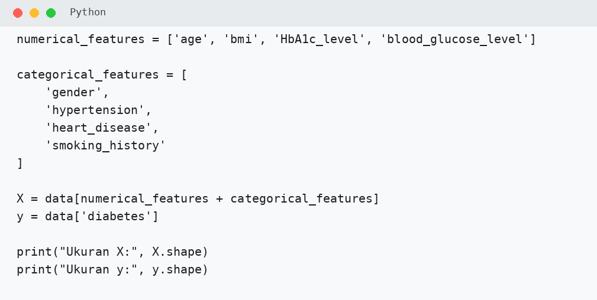

---

## 3. Membuat Preprocessing

Gunakan:

- `StandardScaler` untuk feature numerik,
- `OneHotEncoder` untuk feature kategorikal.

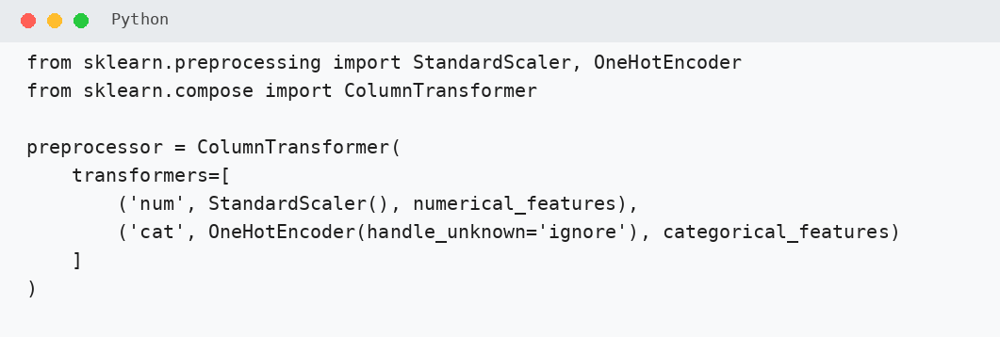

!!! warning "Penting"
    Preprocessing tetap ditempatkan di dalam Pipeline agar tidak terjadi data leakage.

---

## 4. Membuat Model MLP

Gunakan dua hidden layer:

- 64 neuron,
- 32 neuron.

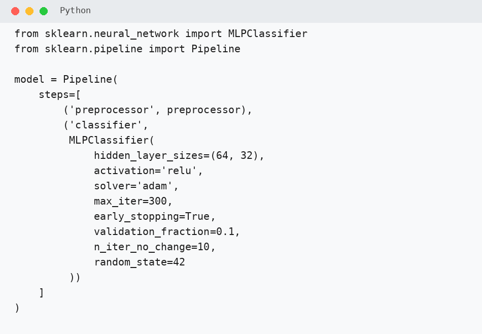

Parameter utama:

- `activation='relu'`
- `solver='adam'`
- `max_iter=300`
- `early_stopping=True`

---

## 5. Membuat Stratified 5-Fold

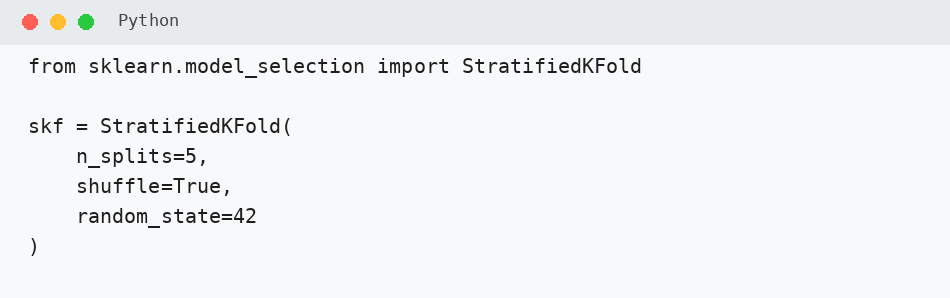

---

## 6. Menyiapkan Metric

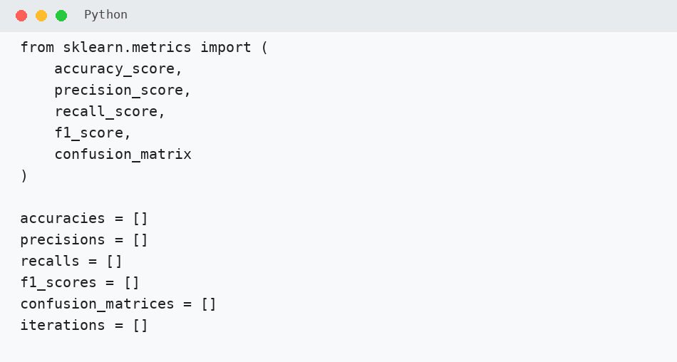

---

## 7. Training dan Testing Setiap Fold

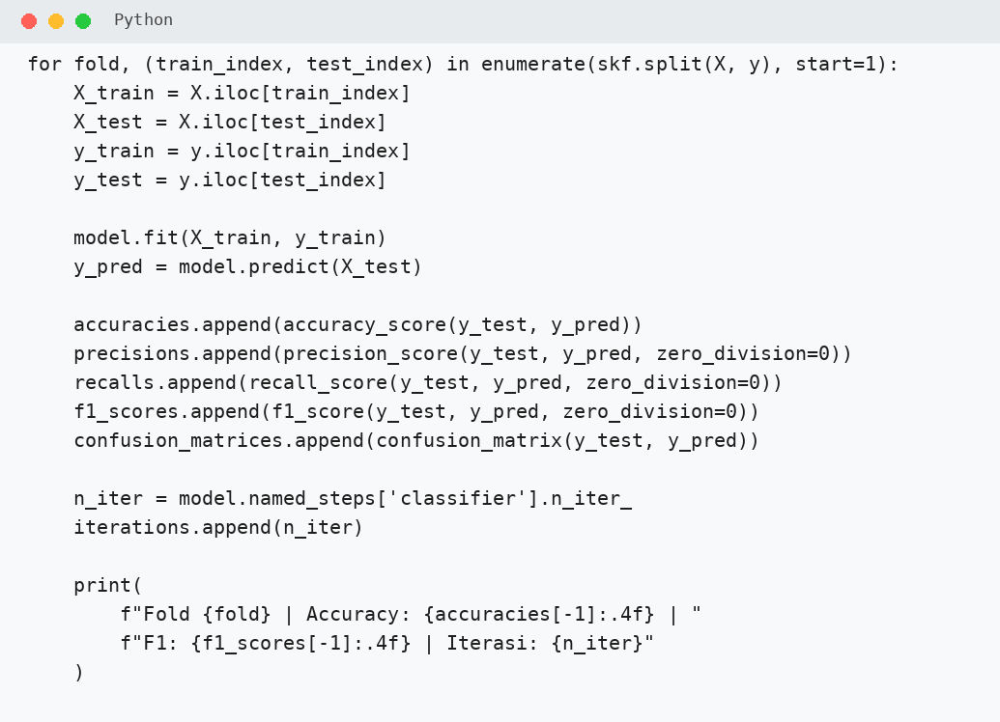

Pada setiap fold:

1. preprocessing dipelajari dari training data,
2. MLP dilatih,
3. prediksi dilakukan,
4. metric dihitung,
5. jumlah iterasi dicatat.

---

## 8. Menghitung Rata-rata Performa

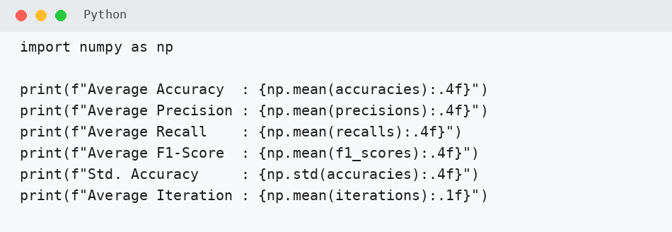

Perhatikan:

- average accuracy,
- average precision,
- average recall,
- average F1-score,
- standar deviasi accuracy,
- average iteration.

---

## 9. Menampilkan Hasil per Fold

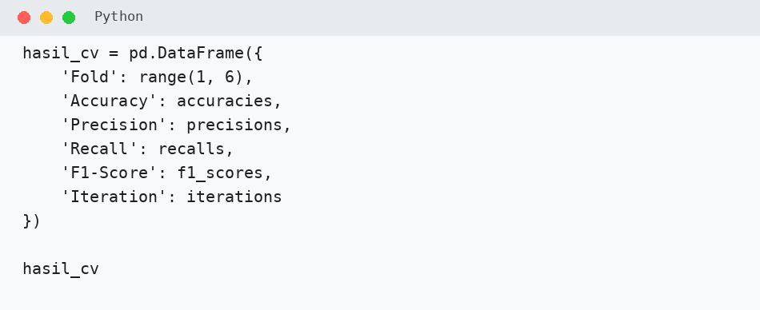

---

## 10. Visualisasi Performa

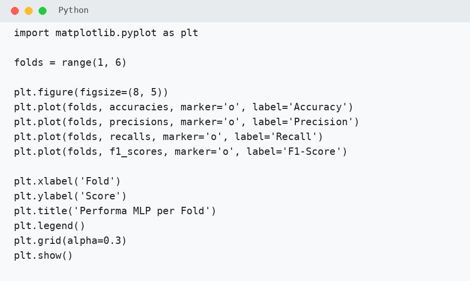

Perhatikan apakah performa antar-fold relatif konsisten.

---

## 11. Menampilkan Confusion Matrix

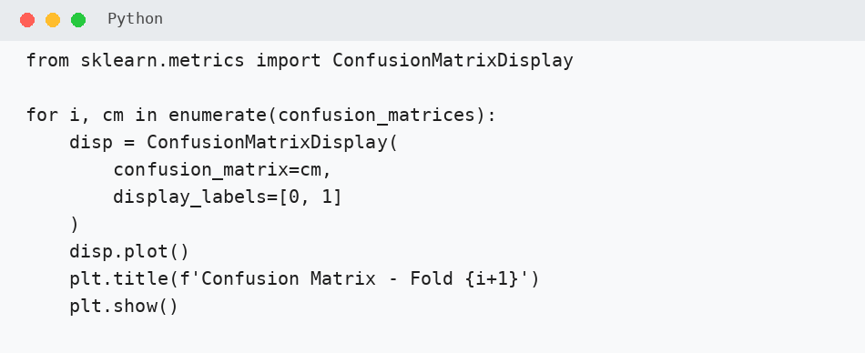

Perhatikan terutama False Positive dan False Negative.

---

# Latihan Praktikum

!!! note "Dikumpulkan"
    **Latihan Praktikum dikumpulkan sebagai notebook tersendiri.**

## 1. Memahami Arsitektur

Berdasarkan:

`hidden_layer_sizes = (64, 32)`

jawab:

1. Berapa hidden layer yang digunakan?
2. Berapa neuron pada hidden layer pertama?
3. Berapa neuron pada hidden layer kedua?
4. Apa fungsi hidden layer secara sederhana?

---

## 2. Hasil Antar-Fold

Lengkapi:

| Fold | Accuracy | Precision | Recall | F1-Score | Iterasi |
|---:|---:|---:|---:|---:|---:|
| 1 | ... | ... | ... | ... | ... |
| 2 | ... | ... | ... | ... | ... |
| 3 | ... | ... | ... | ... | ... |
| 4 | ... | ... | ... | ... | ... |
| 5 | ... | ... | ... | ... | ... |

Jawab:

1. Fold mana yang memiliki accuracy tertinggi?
2. Fold mana yang membutuhkan iterasi paling banyak?
3. Apakah iterasi lebih banyak selalu menghasilkan accuracy lebih tinggi?

---

## 3. Rata-rata Performa

Catat:

| Metric | Nilai |
|---|---:|
| Average Accuracy | ... |
| Average Precision | ... |
| Average Recall | ... |
| Average F1-Score | ... |
| Std. Accuracy | ... |
| Average Iteration | ... |

Jawab:

1. Metric mana yang paling rendah?
2. Apakah hasil antar-fold cukup konsisten?
3. Jelaskan berdasarkan nilai standar deviasi.

---

## 4. Confusion Matrix

Pilih satu fold.

Catat:

- TP
- TN
- FP
- FN

Jawab:

1. Berapa jumlah False Negative?
2. Apa arti False Negative pada klasifikasi diabetes?
3. Metric mana yang lebih sensitif terhadap False Negative?

---

## 5. Pemahaman MLP

Jawab singkat:

1. Apa fungsi `StandardScaler` pada MLP?
2. Apa fungsi activation function?
3. Apa fungsi optimizer?
4. Apa fungsi early stopping?
5. Apa perbedaan sederhana MLP dengan KNN dan SVM?

---

# Tugas Praktikum

!!! info "Pengerjaan Tugas"
    Tugas Praktikum merupakan eksperimen lanjutan.

    Mulai dikerjakan di kelas setelah Latihan Praktikum selesai.

    Jika belum selesai, tugas boleh dilanjutkan di rumah.

    **Tugas Praktikum dikumpulkan sebagai notebook terpisah dari Latihan Praktikum.**

## 1. Membandingkan Arsitektur

Gunakan arsitektur berikut:

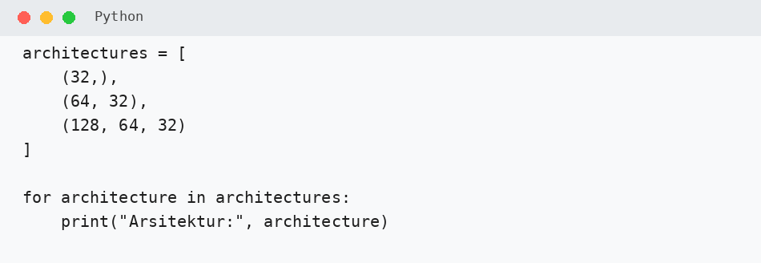

Bandingkan:

- `(32,)`
- `(64, 32)`
- `(128, 64, 32)`

Gunakan Stratified 5-Fold.

| Arsitektur | Accuracy | Precision | Recall | F1-Score | Avg. Iterasi |
|---|---:|---:|---:|---:|---:|
| (32,) | ... | ... | ... | ... | ... |
| (64, 32) | ... | ... | ... | ... | ... |
| (128, 64, 32) | ... | ... | ... | ... | ... |

Tentukan arsitektur dengan F1-score tertinggi.

---

## 2. Analisis Arsitektur Terbaik

Untuk arsitektur terbaik:

1. tampilkan confusion matrix,
2. catat TP, TN, FP, dan FN,
3. jelaskan apakah arsitektur yang lebih dalam selalu lebih baik.

Jawaban maksimal **4 kalimat**.

---

## 3. Membandingkan Activation Function

Gunakan arsitektur `(64, 32)`.

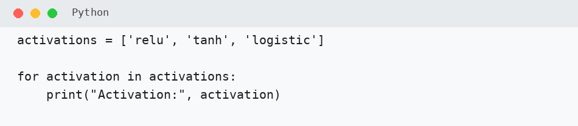

Bandingkan:

- ReLU
- Tanh
- Logistic

| Activation | Accuracy | F1-Score | Avg. Iterasi |
|---|---:|---:|---:|
| ReLU | ... | ... | ... |
| Tanh | ... | ... | ... |
| Logistic | ... | ... | ... |

Activation mana yang menghasilkan F1-score tertinggi?

---

## 4. Early Stopping

Bandingkan:

- Model A → `early_stopping=True`
- Model B → `early_stopping=False`

Gunakan arsitektur `(64, 32)`.

| Model | Accuracy | F1-Score | Avg. Iterasi |
|---|---:|---:|---:|
| Early stopping | ... | ... | ... |
| Tanpa early stopping | ... | ... | ... |

Apa pengaruh early stopping terhadap jumlah iterasi dan performa?

---

## 5. Kesimpulan

Tuliskan maksimal **5 kalimat** mengenai:

1. prinsip dasar MLP,
2. pentingnya scaling,
3. pengaruh jumlah hidden layer/neuron,
4. pengaruh activation function,
5. hasil MLP dibandingkan KNN dan SVM dari modul sebelumnya.

---

# Pengumpulan

Dikumpulkan dalam **dua notebook terpisah**.

## 1. Notebook Latihan Praktikum

Nama file:

`NIM_Nama_Modul07_Latihan.ipynb`

Berisi:

- langkah praktikum utama,
- seluruh output,
- jawaban Latihan Praktikum.

## 2. Notebook Tugas Praktikum

Nama file:

`NIM_Nama_Modul07_Tugas.ipynb`

Berisi:

- eksperimen arsitektur,
- activation function,
- early stopping,
- tabel hasil,
- confusion matrix,
- kesimpulan.

Pastikan seluruh cell telah dijalankan dan output terlihat sebelum dikumpulkan.
