# Modul 08: Dasar Pengolahan dan Preprocessing Citra

## Tujuan

Setelah menyelesaikan praktikum ini, mahasiswa diharapkan mampu:

1. Memahami citra digital sebagai data numerik.
2. Memahami pixel, resolusi, channel, RGB, dan grayscale.
3. Membaca citra dan mengubahnya menjadi NumPy array.
4. Melakukan resize dan normalisasi citra.
5. Melakukan transformasi sederhana: flip, rotate, dan crop.
6. Memahami konsep kernel/filter sebagai pengantar menuju convolution pada CNN.

## Persiapan

Siapkan:

- Google Colab.
- Google Drive.
- Minimal satu file gambar berformat `.jpg` atau `.png`.
- Library `PIL`, `numpy`, `matplotlib`, dan `scipy`.

Buat folder:

`MyDrive/praktikum_ai/images/`

Simpan gambar dengan nama:

`contoh.jpg`

!!! note "Fokus Modul"
    Modul ini bukan membahas seluruh teknik pengolahan citra.

    Fokusnya adalah memahami bagaimana gambar direpresentasikan dan dipersiapkan sebelum digunakan sebagai input model CNN.

---

# Dasar Teori

## 1. Citra Digital sebagai Data

Gambar yang terlihat oleh manusia sebenarnya disimpan sebagai kumpulan angka.

Setiap titik kecil pada gambar disebut **pixel**.

Pixel menyimpan informasi intensitas atau warna.

Contoh gambar grayscale:

```text
0    20   100
30   120  200
10   80   255
```

Nilai pixel umumnya berada pada rentang:

`0 – 255`

---

## 2. Resolusi

Resolusi menyatakan ukuran citra.

Contoh:

```text
1920 × 1080
```

Artinya:

- lebar = 1920 pixel,
- tinggi = 1080 pixel.

Semakin tinggi resolusi, semakin banyak pixel yang harus diproses.

---

## 3. Grayscale dan RGB

### Grayscale

Citra grayscale hanya mempunyai satu channel.

Bentuk array:

```text
(height, width)
```

### RGB

Citra RGB mempunyai tiga channel:

- Red
- Green
- Blue

Bentuk array:

```text
(height, width, 3)
```

Contoh nilai satu pixel RGB:

```text
[120, 200, 80]
```

---

## 4. Citra sebagai NumPy Array

Ketika gambar diubah menjadi NumPy array, kita dapat melihat:

- shape,
- tipe data,
- nilai minimum,
- nilai maksimum,
- nilai pixel tertentu.

Ini penting karena model Machine Learning menerima angka, bukan "gambar" seperti yang dilihat manusia.

---

## 5. Resize

Model membutuhkan ukuran input yang konsisten.

Misalnya semua gambar diubah menjadi:

```text
128 × 128
```

Resize membantu menyamakan bentuk input.

Namun resize juga dapat menyebabkan:

- detail hilang,
- bentuk terdistorsi,
- informasi penting berkurang.

!!! warning "Perhatikan Aspect Ratio"
    Mengubah gambar persegi panjang menjadi persegi tanpa memperhatikan proporsi dapat membuat objek tampak melebar atau memanjang.

---

## 6. Normalisasi

Nilai pixel biasanya berada pada rentang:

```text
0 – 255
```

Untuk training Neural Network, pixel sering diubah menjadi:

```text
0 – 1
```

dengan:

```text
pixel / 255
```

Normalisasi membuat skala input lebih terkendali.

---

## 7. Transformasi Citra

Beberapa transformasi sederhana:

- horizontal flip,
- rotation,
- crop.

Transformasi dapat digunakan untuk:

- mengeksplorasi citra,
- mempersiapkan data,
- menjadi dasar konsep data augmentation.

!!! question "Pertanyaan"
    Apakah semua transformasi selalu aman?

    Tidak. Transformasi tidak boleh mengubah arti label.

---

## 8. Kernel / Filter

Kernel adalah matriks kecil yang digeser di atas citra.

Contoh:

```text
 0  -1   0
-1   4  -1
 0  -1   0
```

Kernel digunakan untuk menonjolkan pola tertentu pada gambar.

Misalnya:

- tepi,
- tekstur,
- perubahan intensitas.

Konsep ini penting karena pada CNN terdapat operasi **convolution** yang menggunakan filter/kernel.

---

## 9. Hubungan dengan CNN

Alur sederhana:

```text
Image
  ↓
Resize
  ↓
Normalisasi
  ↓
Convolution
  ↓
Feature Map
  ↓
CNN
```

Modul berikutnya akan membahas klasifikasi citra dengan CNN.

---

# Langkah-langkah Praktikum

## 1. Menghubungkan Google Drive

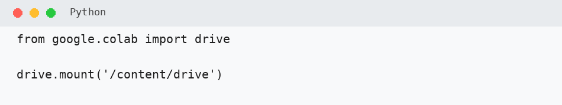

---

## 2. Import Library

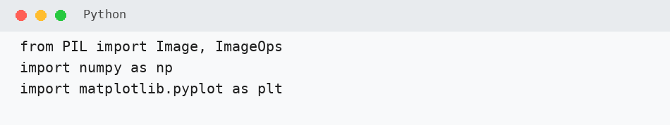

---

## 3. Membaca dan Menampilkan Gambar

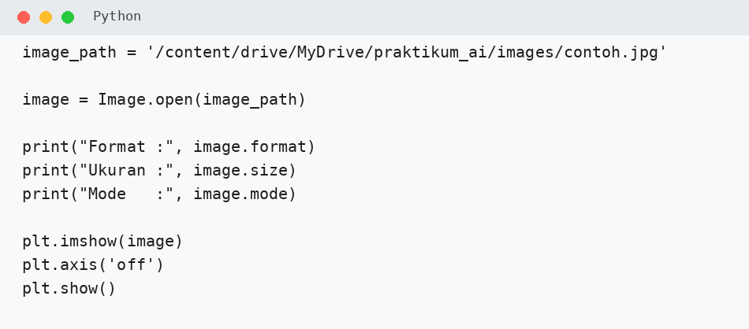

Perhatikan:

- format,
- ukuran,
- mode warna.

---

## 4. Mengubah Gambar menjadi NumPy Array

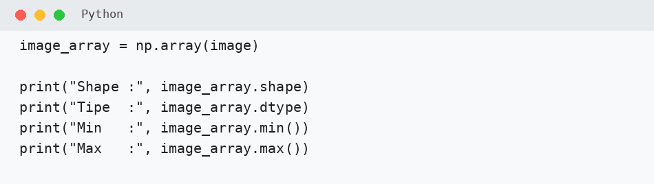

Catat:

- `shape`,
- `dtype`,
- nilai minimum,
- nilai maksimum.

---

## 5. Melihat Nilai Pixel

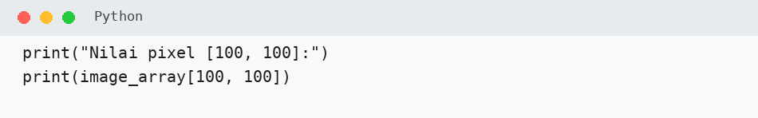

Pada gambar RGB, satu pixel memiliki tiga nilai.

---

## 6. Memisahkan Channel RGB

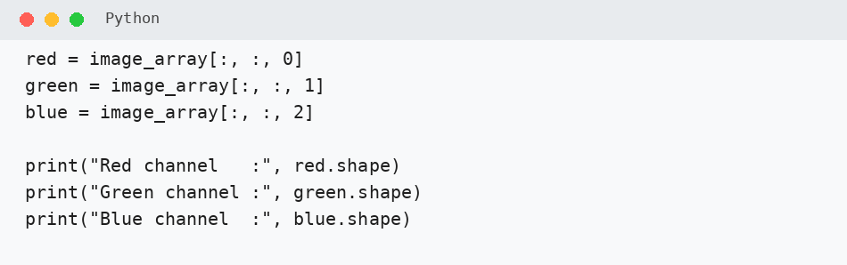

Tampilkan masing-masing channel.

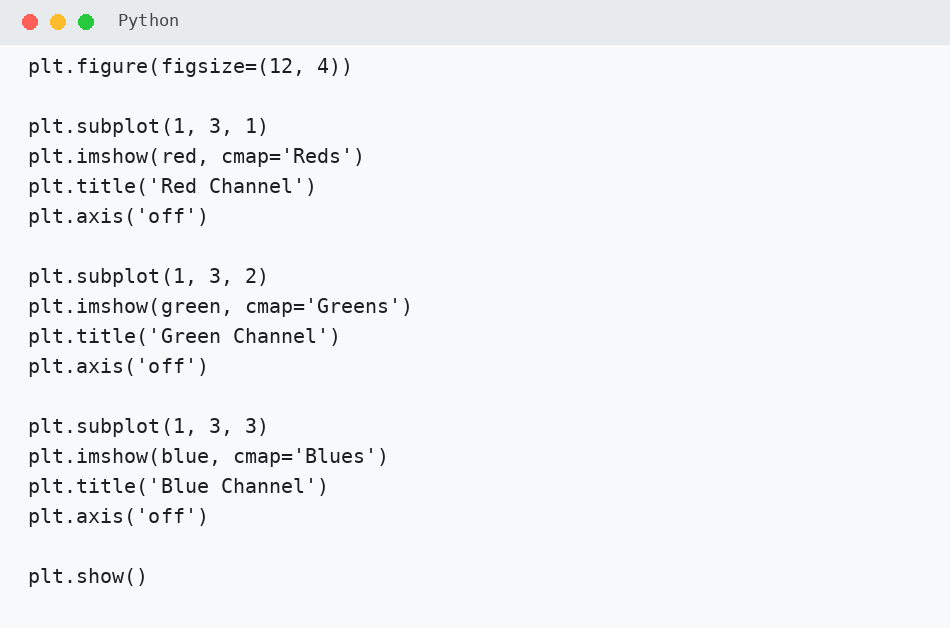

---

## 7. Mengubah RGB menjadi Grayscale

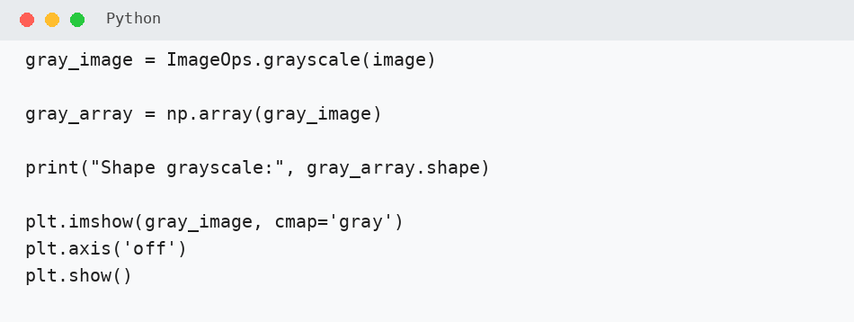

Bandingkan bentuk array RGB dan grayscale.

---

## 8. Resize Gambar

Ubah gambar menjadi:

`128 × 128`

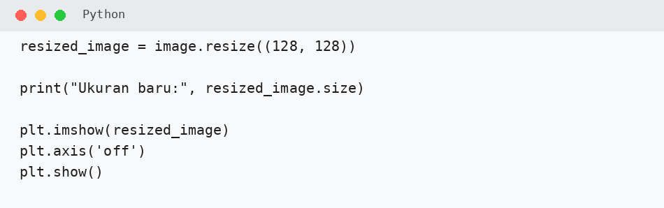

Bandingkan dengan gambar asli.

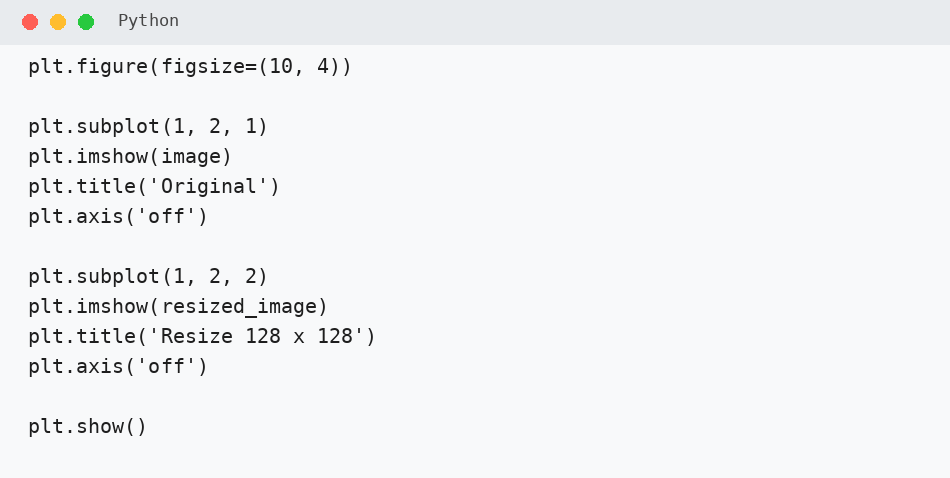

---

## 9. Normalisasi Pixel

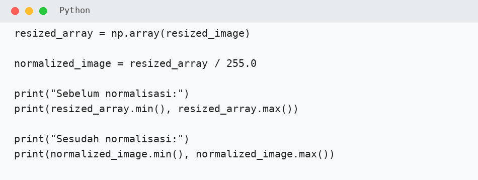

Perhatikan perubahan range:

```text
0–255
```

menjadi:

```text
0–1
```

---

## 10. Transformasi Gambar

Buat:

- horizontal flip,
- rotation,
- crop.

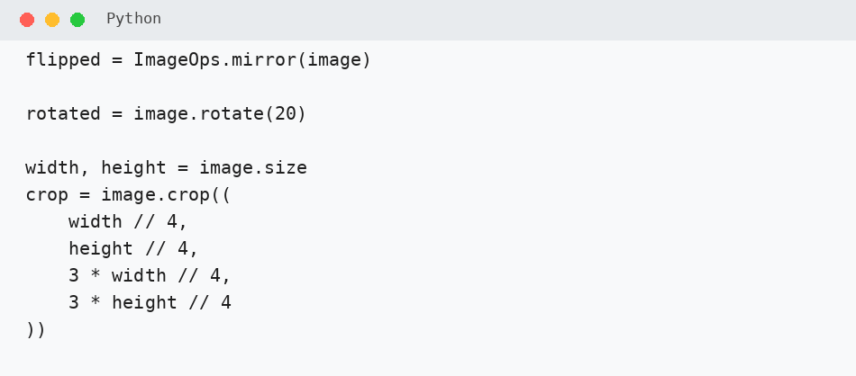

Tampilkan hasilnya.

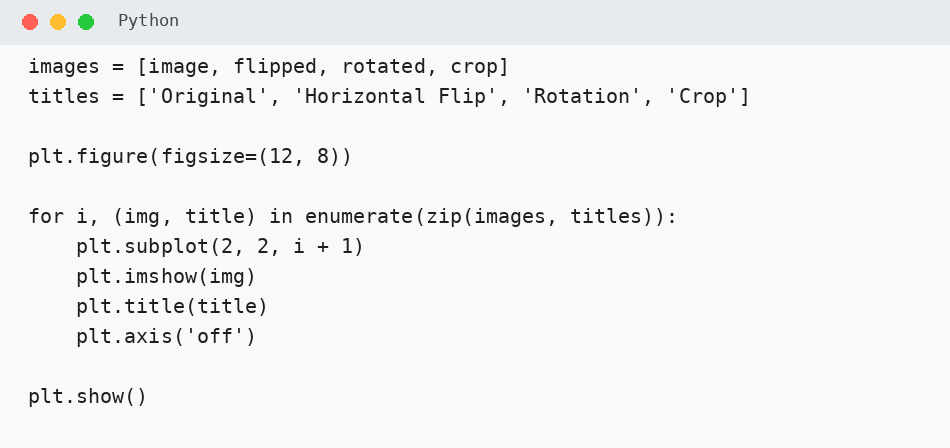

---

## 11. Mengenal Kernel

Gunakan kernel sederhana.

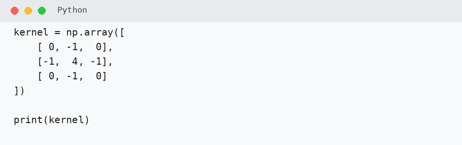

---

## 12. Menghitung Satu Operasi Kernel secara Manual

Gunakan patch 3 × 3.

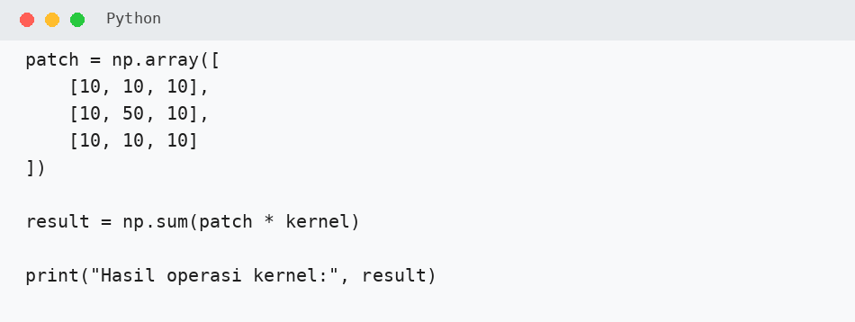

Perhitungan dilakukan dengan:

1. mengalikan setiap elemen patch dengan kernel,
2. menjumlahkan seluruh hasil.

!!! note "Tujuan"
    Kita belum menghitung seluruh feature map.

    Tujuannya hanya memahami ide dasar operasi convolution sebelum masuk ke CNN.

---

## 13. Menerapkan Filter ke Gambar

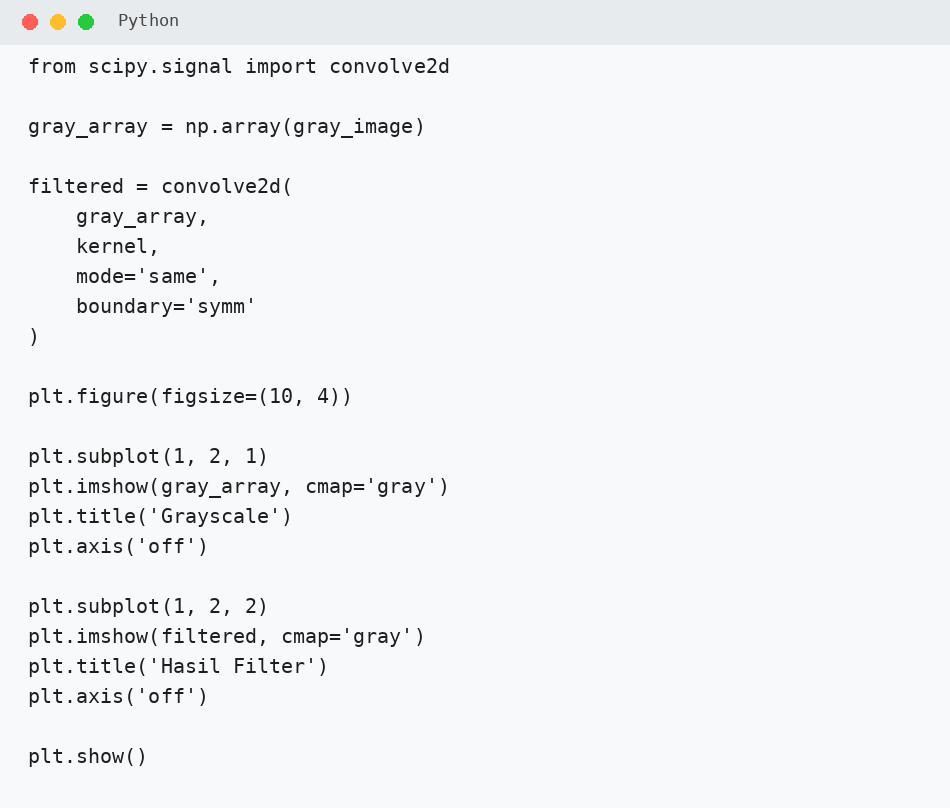

Bandingkan:

- citra grayscale,
- hasil filter.

---

# Latihan Praktikum

!!! note "Dikumpulkan"
    **Latihan Praktikum dikumpulkan sebagai notebook tersendiri.**

## 1. Shape dan Channel

Catat:

| Informasi | Nilai |
|---|---|
| Ukuran gambar | ... |
| Shape array RGB | ... |
| Jumlah channel | ... |
| Tipe data | ... |

Jawab:

1. Apa arti setiap angka pada `shape` citra RGB?
2. Mengapa citra RGB memiliki tiga channel?

---

## 2. Nilai Pixel

Pilih satu koordinat pixel.

Catat:

```text
Pixel [baris, kolom] = [...]
```

Jawab:

1. Berapa nilai Red?
2. Berapa nilai Green?
3. Berapa nilai Blue?
4. Mengapa satu pixel RGB memiliki tiga nilai?

---

## 3. RGB dan Grayscale

Bandingkan:

| Citra | Shape |
|---|---|
| RGB | ... |
| Grayscale | ... |

Jawab:

1. Apa perbedaan jumlah dimensinya?
2. Informasi apa yang hilang ketika RGB diubah menjadi grayscale?

---

## 4. Resize dan Normalisasi

Catat:

| Kondisi | Nilai |
|---|---|
| Ukuran asli | ... |
| Ukuran setelah resize | 128 × 128 |
| Range pixel sebelum normalisasi | ... |
| Range pixel setelah normalisasi | ... |

Jawab:

1. Mengapa gambar perlu memiliki ukuran yang sama sebelum masuk ke CNN?
2. Mengapa pixel dinormalisasi?

---

## 5. Transformasi dan Kernel

Amati:

- horizontal flip,
- rotation,
- crop,
- hasil filter.

Jawab:

1. Transformasi mana yang paling banyak mengubah isi gambar?
2. Apakah label objek masih tetap benar setelah semua transformasi?
3. Apa fungsi kernel secara sederhana?
4. Apa hubungan kernel pada modul ini dengan CNN?

---

# Tugas Praktikum

!!! info "Pengerjaan Tugas"
    Tugas merupakan eksperimen lanjutan.

    Mulai dikerjakan di kelas setelah Latihan Praktikum selesai.

    Jika belum selesai, boleh dilanjutkan di rumah.

    **Tugas Praktikum dikumpulkan sebagai notebook terpisah dari Latihan Praktikum.**

## 1. Mengumpulkan Gambar

Ambil sendiri minimal **5 gambar** dengan kamera smartphone.

Gunakan objek dengan kategori yang sama.

Contoh:

- jalan,
- kendaraan,
- makanan,
- tanaman,
- objek rumah tangga.

Simpan dalam satu folder.

---

## 2. Memeriksa Properti Setiap Gambar

Untuk setiap gambar, tampilkan:

- nama file,
- ukuran,
- mode,
- shape array.

Buat tabel:

| File | Width | Height | Mode | Shape |
|---|---:|---:|---|---|
| img01.jpg | ... | ... | ... | ... |
| img02.jpg | ... | ... | ... | ... |
| ... | ... | ... | ... | ... |

---

## 3. Preprocessing

Untuk seluruh gambar:

1. ubah ke RGB jika diperlukan,
2. resize menjadi `128 × 128`,
3. normalisasi menjadi `0–1`.

Tampilkan minimal tiga gambar hasil preprocessing.

---

## 4. Transformasi

Untuk minimal tiga gambar, buat:

- horizontal flip,
- rotation,
- crop.

Tampilkan dalam bentuk grid:

```text
Original | Flip | Rotation | Crop
```

Jawab:

1. Transformasi mana yang masih mempertahankan label?
2. Apakah ada transformasi yang berpotensi membuat gambar tidak layak digunakan?

---

## 5. Kesimpulan

Tuliskan maksimal **5 kalimat** mengenai:

1. gambar sebagai data numerik,
2. fungsi resize,
3. fungsi normalisasi,
4. fungsi transformasi,
5. hubungan kernel/filter dengan CNN.

---

# Pengumpulan

Dikumpulkan dalam **dua notebook terpisah**.

## 1. Notebook Latihan Praktikum

Nama file:

`NIM_Nama_Modul08_Latihan.ipynb`

Berisi:

- seluruh langkah praktikum utama,
- output,
- jawaban Latihan Praktikum.

## 2. Notebook Tugas Praktikum

Nama file:

`NIM_Nama_Modul08_Tugas.ipynb`

Berisi:

- gambar yang dikumpulkan,
- tabel properti gambar,
- preprocessing,
- visualisasi transformasi,
- kesimpulan.

Pastikan seluruh cell telah dijalankan dan semua output gambar terlihat sebelum dikumpulkan.

---

# Pengantar Modul Berikutnya

Pada modul ini kita telah melihat bahwa:

- gambar adalah array,
- pixel memiliki nilai,
- citra dapat di-resize dan dinormalisasi,
- kernel dapat digunakan untuk menangkap pola tertentu.

Pada **Modul 09**, konsep tersebut akan digunakan untuk membangun:

**Convolutional Neural Network (CNN) untuk klasifikasi citra.**
